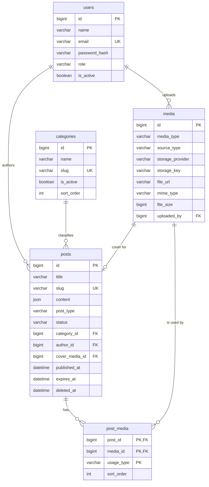

# Campus Kabar --- Project Guide

**Document type:** Product, architecture, and AI-agent working guide\
**Status:** Living source of truth --- update this document when an
approved decision changes\
**Project:** Campus Kabar\
**Version:** 1.0 (initial build guide)

------------------------------------------------------------------------

## 1. What We Are Building

Campus Kabar is a centralized campus publishing platform --- a digital
newspaper and content-management system for campus-related information.

The organization operating Campus Kabar publishes official campus news,
long-form articles, notices, announcements, event updates, photographs,
videos, posters, and other relevant media. Students, staff, parents, and
visitors can discover and read this content from one public website.

The product must be more than a simple notice board. It must support a
proper editorial publishing experience: an authorized content editor
should be able to write an article and place images, video embeds, and
other supported media **inside the body of the content**, in the
intended positions. Media should also be attachable as a cover image,
gallery, or downloadable attachment where appropriate.

### Core product idea

> One trusted, mobile-friendly place to publish, manage, discover, and
> read campus news, articles, notices, and multimedia content.

## 2. Product Goals

1.  Centralize official campus news, articles, notices, and
    announcements.
2.  Give authorized staff a straightforward way to create, edit, review,
    and publish content without needing technical help.
3.  Provide a rich editorial experience, including formatted text and
    inline multimedia.
4.  Make content easy to discover by content type, category, date, and
    keyword.
5.  Provide a clean, readable, mobile-first public experience.
6.  Keep the system maintainable, secure, and suitable for future
    growth.

## 3. Users, Roles, and Access

### Public visitor / reader

-   Can browse and read published content without creating an account.
-   Can search and filter public content.
-   Can browse categories and media galleries.
-   Cannot create, edit, or manage content.
-   No public registration or login is required for Version 1.

### Admin

-   Has full administrative control.
-   Can manage staff accounts and roles.
-   Can manage categories and platform-level settings.
-   Can create, edit, publish, unpublish, feature, archive, and delete
    content.
-   Can access the admin dashboard and content-management tools.

### Editor

-   Is an authorized staff member who creates and manages editorial
    content.
-   Can create and edit news, articles, notices, and announcements.
-   Can upload and insert supported media.
-   Can save drafts and publish content if that permission is granted.
-   Cannot manage admin accounts, roles, or sensitive platform settings
    unless explicitly granted.

**Access-control principle:** The public can read published content.
Only authenticated and authorized staff can access the
content-management area. Admin and editor permissions must be enforced
by the backend API, not merely hidden in the frontend.

### Roles in the `users` table

The `users` table stores a `role` column with three supported values:
`admin`, `editor`, and `reader`. This is a schema-level capability only:
reader registration, reader login, and any reader-facing account feature
remain out of scope for Version 1. No `reader` rows are created in
Version 1. The database is shaped so reader accounts can be enabled
later without a destructive migration.

The exact permission split between Admin and Editor can be refined, but
do not introduce public user accounts in Version 1 without an explicit
product decision.

## 4. Content Model and Publishing Concepts

Use one shared content model for the main publishing workflow, with a
field that identifies the content type.

### Content types

-   **News:** timely campus updates and reports.
-   **Article:** longer-form editorial or informational writing.
-   **Notice:** formal information such as exam schedules, deadlines,
    holidays, and administrative notices. Notices may have an expiry
    date.
-   **Announcement:** short official updates or communications.

These are content types, not topical categories. A post's type answers
"what kind of content is this?" A category answers "what topic is it
about?"

### Categories

Categories are managed by authorized staff and classify content by
topic. Initial suggested categories:

-   Exams and Results
-   Admissions
-   Events and Programs
-   Sports
-   Clubs and Student Activities
-   Achievements
-   Seminars and Workshops
-   Holidays and Calendar
-   General News

The list is configurable. Do not hard-code category names into
application logic.

### Publishing states

At minimum, support:

-   `draft` --- saved but not publicly visible.
-   `published` --- visible on the public portal.
-   `unpublished` --- removed from public visibility but retained in the
    system.

A future review/approval state may be added if the editorial workflow
requires it. Do not build a complex approval workflow without an
approved requirement.

### Important content fields

A content item should support:

-   Title
-   Unique URL slug
-   Short summary / excerpt
-   Rich-text body
-   Content type
-   Category
-   Author
-   Status
-   Cover image
-   Tags (if enabled)
-   Featured/pinned flag
-   Publication date/time
-   Optional expiry date/time (especially for notices)
-   Created and updated timestamps
-   Optional soft-delete timestamp

## 5. Rich Content Editor and Media

A central requirement is a rich content editor. It must not be limited
to a plain textarea or a list of attachments.

### Editor capabilities

The authoring interface should support:

-   Headings and paragraphs
-   Bold, italic, underline, and inline links
-   Ordered and unordered lists
-   Block quotes
-   Images inserted between paragraphs
-   Video embeds from approved providers (for example, YouTube)
-   Uploaded video where supported
-   Captions and alternative text for images
-   Poster and PDF attachments
-   Image galleries
-   Preview before publishing

**Preferred editor to evaluate:** TipTap for React. Editor.js is a
possible alternative, but choose one and keep the editor integration
maintainable.

Store editor content as structured JSON (for example, TipTap's document
JSON) in MySQL. The content structure should preserve the order and
placement of inline media. Store media metadata and storage URLs
separately; reference media records from the editor document where
appropriate.

Do not store large image/video binary files directly in MySQL. Use a
suitable file/object-storage service and keep file metadata and URLs in
the database.

### Initial media constraints from the product requirements

These are proposed limits and can be adjusted after selecting the
storage provider:

-   Images: JPG, PNG, or WebP; up to 5 MB each; up to 20 images per
    post.
-   Videos: uploaded MP4 or an embedded YouTube link; uploaded video up
    to 100 MB.
-   Posters: image or PDF; up to 10 MB per file.

Validate file size, extension, MIME type, and actual file content where
practical. Never trust the filename or browser-provided MIME type alone.
Restrict embedded media to approved providers and validate URLs.

## 6. Version 1 Scope

### Public website

-   Home page with featured/pinned content and latest content.
-   News and article listing pages.
-   Notice and announcement listing/section.
-   Content detail page with rich body content and media.
-   Category browsing.
-   Search by keyword.
-   Filters by content type, category, and date where relevant.
-   Media gallery for recent photos/videos.
-   Responsive layout for phones, tablets, and desktops.
-   Public reading without registration.

### Staff/admin application

-   Secure staff login.
-   Role-based admin/editor access.
-   Dashboard with useful content counts and recent activity.
-   Create and edit content.
-   Rich-text editing with inline media.
-   Upload and manage media.
-   Save drafts, publish, and unpublish.
-   Feature/pin important content.
-   Manage content list with search, filters, and sorting.
-   Manage categories (Admin).
-   Manage staff accounts and roles (Admin).

### Not included unless separately approved

-   Public registration and reader accounts.
-   Comments, likes, and user-generated submissions.
-   Native Android or iOS applications.
-   Push, email, or SMS notifications.
-   Multiple languages.
-   Complex editorial approval chains.
-   Multi-campus tenancy or campus-specific data isolation.

Do not quietly add out-of-scope features. Record proposed additions as
decisions for approval.

## 7. Technology Stack

Use the following stack unless a technical constraint is discovered and
discussed before changing it.

  -----------------------------------------------------------------------
  Layer                   Technology              Responsibility
  ----------------------- ----------------------- -----------------------
  Frontend                React (JavaScript)      Public portal and
                                                  staff/admin interface

  Backend                 Node.js + Express       REST API,
                                                  authentication,
                                                  authorization, business
                                                  rules

  Database                MySQL 8                 Users, content,
                                                  categories, media
                                                  metadata, tags

  Database driver         `mysql2`                MySQL connection pool
                                                  and parameterized
                                                  queries

  Migrations and query    Knex.js                 Versioned schema
  builder                                         migrations and query
                                                  building

  Rich-text editor        TipTap (preferred)      Structured editorial
                                                  content and inline
                                                  media

  Media storage           Cloudinary or suitable  Image, video, and
                          object storage          document files

  Authentication          JWT access tokens +     Staff authentication
                          opaque rotating         and password hashing
                          refresh tokens, bcrypt
                          (cost 12)

  Styling                 Tailwind CSS (optional) Consistent responsive
                                                  UI

  Version control         Git + GitHub            Source control and
                                                  collaboration
  -----------------------------------------------------------------------

Use JavaScript rather than TypeScript for the initial implementation
unless we explicitly decide otherwise.

Use environment variables for secrets and configuration. Never commit
`.env` files or credentials.

## 8. High-Level Architecture

Use a clear separation of responsibilities:

1.  **React client:** renders public pages and protected staff/admin
    pages.
2.  **Express API:** validates requests, authenticates staff, checks
    permissions, applies business rules, and returns JSON.
3.  **MySQL:** stores relational application data and structured editor
    JSON.
4.  **Media storage:** stores uploaded files; MySQL stores their
    metadata and references.
5.  **External media embeds:** render only approved and validated embed
    providers.

The frontend must not connect directly to MySQL. All database access
goes through the backend API.

Keep the backend organized by responsibility (routes, controllers,
services, middleware, database, validators, and configuration). Avoid
putting the entire application into one file. Do not over-engineer with
microservices.

## 9. Database Design (Approved)

Status: approved in Milestone 0 and implemented in Milestone 2 with
Knex migrations. This section is the authoritative schema reference;
where it differs from earlier drafts, this section wins.

### Conventions

-   MySQL 8, InnoDB, `utf8mb4` / `utf8mb4_0900_ai_ci`.
-   Primary keys are `BIGINT UNSIGNED AUTO_INCREMENT`.
-   Timestamps are `DATETIME(3)` stored in UTC. Every pooled connection
    runs `SET time_zone = '+00:00'`, and the driver is configured with
    `timezone: 'Z'`. Display timezones are a presentation concern.
-   Enumerations are `VARCHAR` columns guarded by named `CHECK`
    constraints instead of MySQL `ENUM`, so adding an allowed value is
    a metadata-only change. Knex has no schema builder API for `CHECK`,
    so migrations use `knex.raw()` for these constraints.
-   Files are never stored in MySQL. The `media` table stores metadata
    and a reference to the object in external storage.
-   No `campuses` table or `campus_id` until multi-campus operation is
    decided. Do not assume a tenancy model.

### ER diagram

### `users`

One table for every person who can sign in. Every row is a real account
with a password hash; there is no passwordless account in Version 1.

| Column          | Type                | Null | Notes                                     |
| --------------- | ------------------- | ---- | ----------------------------------------- |
| `id`            | BIGINT UNSIGNED PK  | no   | Auto-increment                            |
| `name`          | VARCHAR(120)        | no   | Display name                              |
| `email`         | VARCHAR(255)        | no   | Unique; stored lower-case by the service  |
| `password_hash` | VARCHAR(255)        | no   | bcrypt/Argon2 hash, never plaintext       |
| `role`          | VARCHAR(16)         | no   | `admin`, `editor`, `reader`; default `editor` |
| `is_active`     | BOOLEAN             | no   | Default TRUE                               |
| `created_at`    | DATETIME(3)         | no   | UTC                                        |
| `updated_at`    | DATETIME(3)         | no   | UTC                                        |

-   `CHECK (role IN ('admin','editor','reader'))`.
-   `reader` is reserved for a future reader-account feature. No reader
    rows are created in Version 1, and readers do not register or log
    in. Because `password_hash` is NOT NULL, introducing passwordless
    readers later requires a migration.
-   Accounts are deactivated with `is_active = FALSE`, not deleted, so
    authorship history stays intact.

### `categories`

| Column        | Type               | Null | Notes                                    |
| ------------- | ------------------ | ---- | ---------------------------------------- |
| `id`          | BIGINT UNSIGNED PK | no   | Auto-increment                           |
| `name`        | VARCHAR(120)       | no   | Unique display name                      |
| `slug`        | VARCHAR(160)       | no   | Unique; public URL segment               |
| `description` | VARCHAR(500)       | yes  | Short public description                 |
| `is_active`   | BOOLEAN            | no   | Default TRUE; inactive hides from public |
| `sort_order`  | INT                | no   | Default 0; navigation order              |
| `created_at`  | DATETIME(3)        | no   | UTC                                      |
| `updated_at`  | DATETIME(3)        | no   | UTC                                      |

Posts reference categories with `ON DELETE RESTRICT`: a category that is
still used cannot be removed. Deactivate it instead.

### `posts`

| Column           | Type               | Null | Notes                                            |
| ---------------- | ------------------ | ---- | ------------------------------------------------ |
| `id`             | BIGINT UNSIGNED PK | no   | Auto-increment                                   |
| `title`          | VARCHAR(255)       | no   |                                                  |
| `slug`           | VARCHAR(255)       | no   | Unique; public URL segment                       |
| `summary`        | VARCHAR(500)       | yes  | Listing teaser                                   |
| `content`        | JSON               | no   | Structured rich-text document (TipTap)           |
| `post_type`      | VARCHAR(16)        | no   | `news`, `article`, `notice`, `announcement`      |
| `category_id`    | BIGINT UNSIGNED    | no   | FK categories, `ON DELETE RESTRICT`              |
| `author_id`      | BIGINT UNSIGNED    | no   | FK users, `ON DELETE RESTRICT`                   |
| `cover_media_id` | BIGINT UNSIGNED    | yes  | FK media, `ON DELETE SET NULL`; at most one cover |
| `status`         | VARCHAR(16)        | no   | `draft`, `published`, `unpublished`; default `draft` |
| `is_featured`    | BOOLEAN            | no   | Default FALSE                                    |
| `published_at`   | DATETIME(3)        | yes  | Set when first published                         |
| `expires_at`     | DATETIME(3)        | yes  | Optional expiry for notices/announcements         |
| `created_at`     | DATETIME(3)        | no   | UTC                                              |
| `updated_at`     | DATETIME(3)        | no   | UTC                                              |
| `deleted_at`     | DATETIME(3)        | yes  | Soft deletion timestamp                          |

Constraints:

-   `CHECK (post_type IN ('news','article','notice','announcement'))`.
-   `CHECK (status IN ('draft','published','unpublished'))`.
-   `CHECK (status <> 'published' OR published_at IS NOT NULL)` — a
    published post always has a publication time.
-   `CHECK (expires_at IS NULL OR published_at IS NULL OR expires_at > published_at)`.

A post has exactly one category in Version 1. `cover_media_id` is the
single source of truth for the cover image; the cover is not duplicated
in `post_media`.

### `media`

Metadata for images, videos, and documents stored in object storage, plus
external video embeds. One row per stored or embedded asset; rows are
reusable across posts.

| Column              | Type                | Null | Notes                                                    |
| ------------------- | ------------------- | ---- | -------------------------------------------------------- |
| `id`                | BIGINT UNSIGNED PK  | no   | Auto-increment                                           |
| `media_type`        | VARCHAR(16)         | no   | `image`, `video`, `document`                             |
| `source_type`       | VARCHAR(16)         | no   | `upload` (Cloudinary) or `external` (embed)              |
| `storage_provider`  | VARCHAR(32)         | no   | e.g. `cloudinary`, `youtube`; keeps documents portable   |
| `storage_key`       | VARCHAR(512)        | no   | Cloudinary `public_id`, or provider video ID             |
| `file_url`          | VARCHAR(1024)       | no   | Delivery URL                                             |
| `file_name`         | VARCHAR(255)        | yes  | Original or generated name                               |
| `mime_type`         | VARCHAR(127)        | no   | Verified server-side, never trusted from the client      |
| `file_size`         | BIGINT UNSIGNED     | yes  | Bytes; NULL only for external embeds                     |
| `alt_text`          | VARCHAR(255)        | yes  | Accessibility text                                       |
| `width`             | INT UNSIGNED        | yes  | Pixels; NULL until known                                 |
| `height`            | INT UNSIGNED        | yes  | Pixels; NULL until known                                 |
| `duration_seconds`  | DECIMAL(10,3)       | yes  | NULL for images/documents and while video processes      |
| `uploaded_by`       | BIGINT UNSIGNED     | yes  | FK users, `ON DELETE SET NULL`                           |
| `created_at`        | DATETIME(3)         | no   | UTC                                                      |

Constraints:

-   `CHECK (media_type IN ('image','video','document'))`.
-   `CHECK (source_type IN ('upload','external'))`.
-   `CHECK (source_type = 'external' OR (file_size IS NOT NULL AND file_size > 0))`.
-   `UNIQUE (storage_provider, storage_key)` — deduplicates repeated
    uploads and makes metadata registration idempotent.

Accepted formats: images JPG/JPEG/PNG/WebP up to 5 MB; video MP4/WebM up
to 100 MB; documents PDF and approved formats up to 10 MB. Formats and
sizes are enforced during signed-upload validation and again by
Cloudinary; the database enforces the structurally invalid cases.

### `post_media`

Junction table for gallery, inline, and attachment usage. The cover is
not stored here; it lives on `posts.cover_media_id`.

| Column       | Type             | Null | Notes                                       |
| ------------ | ---------------- | ---- | ------------------------------------------- |
| `post_id`    | BIGINT UNSIGNED  | no   | FK posts, `ON DELETE CASCADE`               |
| `media_id`   | BIGINT UNSIGNED  | no   | FK media, `ON DELETE RESTRICT`              |
| `usage_type` | VARCHAR(16)      | no   | `gallery`, `inline`, `attachment`           |
| `sort_order` | INT              | no   | Default 0; gallery/attachment ordering      |

-   Composite primary key `(post_id, media_id, usage_type)`.
-   `CHECK (usage_type IN ('gallery','inline','attachment'))`.
-   Secondary index `(media_id, usage_type)` for usage lookups.

Inline placement inside the rich-text document is preserved by the JSON
content itself (media IDs appear at their exact position). The
`post_media` row is the relational reference; a media ID appearing in
`posts.content` must have a matching `post_media` row. Foreign keys
cannot enforce an invariant inside JSON, so the service layer enforces it
on every save.

### Tags

Deferred. No `tags` or `post_tags` tables in Version 1. Adding them later
is additive: `tags` and a `post_tags` join table with a composite primary
key.

### Index plan

| Index                                       | Serves                                        |
| ------------------------------------------- | --------------------------------------------- |
| `users.email` UNIQUE                        | Login lookup                                  |
| `users (role, is_active)`                   | Staff lists and permission checks             |
| `categories.slug` UNIQUE                    | Public category pages                         |
| `categories (is_active, sort_order)`        | Navigation rendering                          |
| `posts.slug` UNIQUE                         | Public post lookup, including soft-deleted    |
| `posts (status, deleted_at, published_at DESC, id)` | Public feed and pagination           |
| `posts (post_type, status, deleted_at, published_at DESC)` | Type-filtered listings       |
| `posts (category_id, status, deleted_at, published_at DESC)` | Category listings          |
| `posts (is_featured, status, deleted_at, published_at DESC)` | Featured content           |
| `posts (author_id, created_at)`             | Staff "my posts" view                         |
| `posts (status, expires_at)`                | Expiry sweep for notices/announcements        |
| `media (storage_provider, storage_key)` UNIQUE | Upload dedupe and metadata registration    |
| `media (media_type, created_at)`            | Media library filtering                       |
| `post_media (media_id, usage_type)`         | "Where is this media used?"                   |

Slugs stay globally unique even with soft deletion. Deleting a post
rewrites its slug to `original-slug--deleted-<id>` so the original slug
can be reused, while the unique constraint keeps working without
NULL-based tricks.

### Deletion rules

| Relationship                    | Rule              | Reason                                        |
| ------------------------------- | ----------------- | --------------------------------------------- |
| `posts.category_id`             | RESTRICT          | Deactivate categories instead of deleting     |
| `posts.author_id`               | RESTRICT          | Deactivate users instead of deleting          |
| `posts.cover_media_id`          | SET NULL          | Cover removal must not delete the post        |
| `media.uploaded_by`             | SET NULL          | Keep the asset when staff leave               |
| `post_media.post_id`            | CASCADE           | Junction rows follow their post               |
| `post_media.media_id`           | RESTRICT          | Never silently drop content references        |

Posts use `deleted_at` (soft delete). Media and categories are not soft
deleted in Version 1.

### Database versus service-layer integrity

| Rule                                                  | Enforced by |
| ----------------------------------------------------- | ----------- |
| Unique email, slug, storage object                     | Database    |
| Enum values, published-needs-`published_at`, expiry ordering, positive file size | Database |
| Referential integrity and delete rules                | Database    |
| Media IDs in `posts.content` exist in `post_media`     | Service     |
| `cover_media_id` belongs to an image and to the post's media set | Service |
| Media metadata (size, MIME, dimensions, duration)      | Service, derived from Cloudinary |
| Slug format, reserved words, slug rewrite on delete    | Service     |
| Email normalisation and uniqueness case-insensitivity | Service + `utf8mb4_0900_ai_ci` |
| Only one published revision / workflow transitions     | Service     |

### Media upload workflow

The backend never proxies file bytes. The browser uploads directly to
Cloudinary using a signature the backend generates, then registers the
result so MySQL only ever holds verified metadata.

1.  Staff member selects a file. The client checks type and size for
    fast feedback only.
2.  The client requests `POST /api/media/signature` with the intended
    `resource_type` and `usage_type`. The backend authenticates the
    request, checks the role, maps `usage_type` to an allowed format and
    size set (cover/gallery/inline image ≤ 5 MB; video ≤ 100 MB;
    attachment document ≤ 10 MB), and returns `timestamp`, `folder`,
    `allowed_formats`, `max_file_size`, `resource_type`, `public_id`,
    and `signature`. The API secret never leaves the backend.
3.  The browser posts the file and signed parameters to
    `https://api.cloudinary.com/v1_1/<cloud>/<resource_type>/upload`.
    Cloudinary re-validates format and size and stores the object.
4.  The browser sends the resulting `public_id` and `resource_type` to
    `POST /api/media` — nothing else is trusted.
5.  The backend calls the Cloudinary Admin API
    (`GET /resources/<resource_type>/upload?public_id=…`, Basic auth) and
    derives `file_url`, `file_name`, `mime_type`, `file_size`, `width`,
    `height`, and `duration_seconds` from the response. Video duration
    can be absent while transcoding is still running, so
    `duration_seconds` stays nullable and the service retries or leaves
    it empty.
6.  The backend inserts the `media` row, deduplicating on
    `(storage_provider, storage_key)`; repeated registration returns the
    existing row. It then attaches the media to the post via
    `post_media` with its `usage_type`, or sets `posts.cover_media_id`.
7.  Rendering uses the stored `file_url`; inline content keeps media IDs
    at their exact position in the JSON document.

Cloudinary restricts PDF/ZIP delivery on some account tiers. Verify the
account's delivery settings before launch; `storage_provider`/
`storage_key` keep the metadata portable to another provider. Direct
browser upload is preferred over proxying through Express because it
avoids buffering 100 MB videos in API memory and keeps delivery on the
CDN.

## 10. Security and Quality Requirements

Security is part of the implementation, not a final polish task.

-   Hash passwords with bcrypt (cost 12) or Argon2. Never store
    plaintext passwords. Require at least 12 characters and do not
    impose arbitrary character-class rules.
-   Return short-lived JWT access tokens (15 minutes) in the response
    body; keep them in frontend memory only, never in `localStorage`.
-   Store refresh tokens as opaque, SHA-256-hashed rows, delivered in an
    HttpOnly cookie, rotated on every use, and scoped to a login session
    so reuse revokes only that session.
-   Protect staff routes with authentication middleware.
-   Enforce role permissions on the server for every protected
    operation.
-   Validate and sanitize all user input.
-   Use parameterized SQL queries; never build SQL by concatenating
    untrusted input.
-   Configure CORS deliberately.
-   Add rate limiting to login and other sensitive endpoints.
-   Use secure token handling. Configure HttpOnly, Secure, and SameSite
    on the refresh cookie, validate Origin/Referer on cookie-based
    endpoints, and add CSRF tokens before using `SameSite=none` for a
    cross-site deployment.
-   Return errors as `{ "error": { "code", "message" } }` without stack
    traces, database details, passwords, tokens, or internal errors.
-   Validate uploads by size, allowed type, MIME, and content where
    practical.
-   Keep secrets in environment variables.
-   Avoid exposing stack traces or sensitive server details to public
    clients.
-   Use HTTPS in production.
-   Back up the database and uploaded media.
-   Make the public site responsive and usable on common modern
    browsers.
-   Optimize images and avoid unnecessarily large assets.
-   Paginate listing APIs; do not return every post at once.
-   Show useful loading, empty, success, and error states in the UI.

## 11. API Design Direction

Build a REST API with consistent naming and response shapes. The exact
endpoints should be designed before implementation.

Likely resource groups:

-   `/api/auth` --- staff login/logout/current-user.
-   `/api/posts` --- public published content and protected content
    management.
-   `/api/categories` --- public category listing and protected
    management.
-   `/api/media` --- protected upload and media management.
-   `/api/tags` --- tag management if included.
-   `/api/admin/dashboard` --- dashboard summaries.
-   `/api/admin/users` --- staff account and role management.

Separate public read endpoints from protected management actions where
that improves clarity. Public APIs must never return drafts or
unpublished content.

Support pagination, filtering, sorting, and predictable validation
errors.

Implemented so far: `GET /api/health`, a public readiness endpoint that
reports whether the API and its database connection are up. Staff
authentication, content, category, media, and admin endpoints are not
implemented yet.

## 12. Suggested Development Milestones

Build incrementally. Each milestone should be implemented, run, tested,
reviewed, and committed before moving on.

### Milestone 0 --- Confirm the plan

-   Read this guide and the original product requirements.
-   Identify unresolved decisions.
-   Propose the architecture and ER diagram.
-   Do not write application code yet.

### Milestone 1 --- Project foundation

-   Create the repository and project structure.
-   Add README, `.gitignore`, environment example, and setup
    instructions.
-   Initialize React and Express in a clear structure.
-   Confirm both development servers run.

### Milestone 2 --- Database foundation

-   Finalize the ER diagram and schema.
-   Create MySQL database and tables using migrations or versioned SQL.
-   Configure a `mysql2` connection pool.
-   Test the connection and basic queries.

### Milestone 3 --- Staff authentication and authorization

-   Create the first Admin account securely through an interactive
    bootstrap that refuses duplicates and never logs passwords.
-   Implement login, refresh-token rotation, logout, and current-user
    handling.
-   Add authentication and role middleware.
-   Rate-limit login attempts and test unauthorized, forbidden, expired,
    rotated, and reused-token requests.

### Milestone 4 --- Content API

-   Implement categories and posts.
-   Add draft/publish/unpublish behavior.
-   Add public listing, detail, search, filters, and pagination.
-   Test that unpublished content is never publicly accessible.

### Milestone 5 --- Media and rich-text authoring

-   Integrate the selected rich-text editor.
-   Implement media storage and upload validation.
-   Support cover, gallery, inline media, video embeds, and attachments.
-   Preserve inline media placement when saving and rendering content.

### Milestone 6 --- Staff/admin interface

-   Build login, dashboard, content list, editor, media controls,
    category management, and staff management.
-   Enforce permissions in both UI and API.

### Milestone 7 --- Public portal

-   Build home, listing, category, search/filter, detail, and media
    gallery pages.
-   Ensure responsive layouts and accessible reading experience.

### Milestone 8 --- Testing, hardening, and deployment

-   Test important user flows and edge cases.
-   Review security, performance, backups, and error handling.
-   Configure production environment and deploy.
-   Document setup, deployment, and maintenance.

## 13. Working Rules for the AI Coding Agent

This section is important. Follow it throughout the project.

1.  **Read this file first** before proposing or changing project
    architecture.
2.  Treat this document as the current project source of truth. If a
    user gives a newer explicit decision, update the relevant section
    and explain the change.
3.  Do not build the entire application in one prompt or make large
    unrelated changes.
4.  Work on one small, clearly defined task at a time.
5.  Before coding a milestone, explain the plan, files likely to change,
    dependencies, and important trade-offs. Wait for approval when the
    task involves architecture, schema, security, or a significant
    dependency.
6.  Do not silently invent requirements. Ask one focused question when a
    missing decision blocks correct implementation. Otherwise record the
    assumption and keep it reversible.
7.  Do not change the selected stack without explaining why and getting
    approval.
8.  Do not add public registration, comments, likes, notifications,
    multi-campus tenancy, or other out-of-scope features without
    approval.
9.  Prefer readable, maintainable code over clever abstractions or
    unnecessary complexity.
10. Use JavaScript and explain unfamiliar Node.js, Express, SQL, React,
    and security concepts when they appear.
11. Do not pretend code has been tested. Run relevant checks where
    possible and report exactly what passed, failed, or could not be
    run.
12. Never delete or overwrite existing work without explaining the
    impact and getting approval.
13. Do not expose, print, commit, or request secrets. Never include real
    credentials in generated files.
14. Use parameterized SQL and validate all inputs.
15. Add or update tests for important behavior.
16. After each task, summarize:
    -   What changed
    -   Which files changed
    -   Why the implementation works
    -   Commands to run
    -   How to test it manually
    -   Any known limitations or next step
17. Keep documentation current when architecture, schema, setup, or
    workflow decisions change.
18. Do not create placeholder features that appear complete but do not
    work. Clearly label unfinished functionality.

### Preferred interaction pattern

For each task:

1.  **Understand:** inspect relevant files and explain the current
    state.
2.  **Plan:** propose the smallest safe implementation.
3.  **Approve:** wait for approval for significant changes.
4.  **Implement:** make only the agreed changes.
5.  **Verify:** run tests, linting, or manual checks that are available.
6.  **Explain:** teach the user what changed and how the code works.
7.  **Commit:** suggest a clear Git commit message after the user
    verifies the result.

## 14. Decisions Still to Confirm

Resolved before Milestone 3 (authentication):

-   JWT access tokens (15-minute expiry) returned in the JSON body and
    sent as `Authorization: Bearer`; held in frontend memory only.
-   Opaque refresh tokens (7-day sliding expiry) in an HttpOnly cookie;
    only SHA-256 hashes are stored in MySQL, rotated transactionally on
    every refresh. Reuse revokes the affected session via `session_id`.
-   bcrypt cost 12; minimum password length 12; generic login errors for
    unknown email, wrong password, and inactive accounts.
-   Cookie `SameSite`/`Secure`/domain settings are configurable; the
    current localhost topology uses `SameSite=lax`. Cross-site cookies
    require CSRF protection first.
-   Login rate limits: 10 attempts per IP and 5 per email per 15 minutes,
    using an in-memory store (single-instance limitation recorded).
-   No public registration, no Reader login, and no logout-all-devices
    endpoint in Version 1.

Resolved before Milestone 2:

-   One `users` table with `admin`, `editor`, and `reader` roles.
    `password_hash` is NOT NULL; no reader accounts or reader login in
    Version 1.
-   MySQL 8 with `mysql2` and Knex.js migrations.
-   Cloudinary as the initial media provider, with signed direct
    browser uploads and backend verification.
-   Images, real videos, and documents are all uploaded in Version 1;
    external video embeds are also allowed.
-   Each post has exactly one category; the cover is stored on
    `posts.cover_media_id`.
-   Tags are deferred and are not part of Version 1.

Still open; do not guess these:

-   Is Campus Kabar for one campus/organization only, or should it
    support multiple campuses in the future?
-   Can Editors publish directly, or must an Admin approve their drafts?
-   Which language will Version 1 use?
-   Which hosting environment will be used?
-   Is keyword search across post bodies required in Version 1? If so,
    a denormalised `posts.content_text` column with a FULLTEXT index
    should be added by migration.
-   Is an audit trail required for content and staff actions?
-   How long should soft-deleted posts be retained before permanent
    removal?
-   Which display timezone should staff and public pages use?

Where a decision does not block the current milestone, record it and
continue without prematurely implementing it.

## 15. Definition of a Successful Version 1

Version 1 is successful when:

-   A public visitor can open Campus Kabar and read published news,
    articles, notices, and announcements without logging in.
-   Visitors can find content through categories, search, and relevant
    filters.
-   An authorized staff member can log in and create a rich content
    item.
-   The editor can place images and supported video inside the body, not
    only attach them at the end.
-   Staff can save drafts, publish, edit, unpublish, and feature content
    according to their permissions.
-   Notices can have optional expiry dates.
-   Admins can manage categories and staff access.
-   The API protects private management operations and never exposes
    drafts publicly.
-   The application is responsive, reasonably fast, documented, and
    deployable.
-   The user understands the main parts of the codebase and can run the
    project locally.

------------------------------------------------------------------------

**Final instruction to the AI agent:** Start with Milestone 0. Read this
document, inspect any supplied product requirements, identify conflicts
or unresolved decisions, and propose the architecture and ER diagram. Do
not generate the full application or start coding until the plan is
reviewed.
