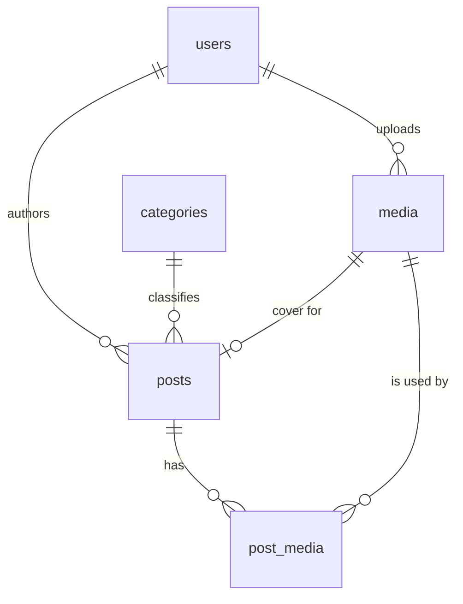

# Campus Kabar — Development Progress Report

**Date:** 17 November 2026
**Branch:** `feat/content-management` (HEAD `a0cf68c`; doc-only correction committed on this branch)
**Scope covered:** Milestone 0 (design), Milestone 2 (database foundation, `2a3eb31`), the Express backend foundation (`bb1d321`, merged into `develop` by PR #1 as `d055b53`), Stage 1 of Milestone 3 (authentication decisions, environment configuration, refresh-token migration, Admin bootstrap, committed as `8fbdf4d`), and Stage 2 of Milestone 3 (auth endpoints, middleware, wiring — implemented, verified, committed as `fd429a0`, and pushed to origin)
**Report status:** factual snapshot of the working tree and the isolated test database. Stage 1 was verified against a disposable MySQL 8 container; the development database was not touched. Stage 1 and Stage 2 are committed on `feat/authentication` and pushed to origin.

---

## Next Session Handoff

**Read this section first.** Snapshot after Stage 1 of Milestone 3 was implemented and verified.

### Status

| Item | State |
| --- | --- |
| Branch / HEAD | `feat/authentication` / `8fbdf4d` (no upstream yet; not pushed) |
| Milestone 0 — design | Complete; approved schema recorded in the guide §9 |
| Milestone 1 — project foundation | Complete: React/Vite frontend template plus the Express API entry point |
| Milestone 2 — database foundation | Implemented, verified, committed as `2a3eb31` |
| Express backend foundation | Implemented, verified, committed as `bb1d321`; merged into `develop` by PR #1 (`d055b53`) |
| Milestone 3 — Stage 1 | **Implemented, verified, committed as `8fbdf4d`** |
| Milestone 3 — Stage 2 | **Implemented, verified, committed as `fd429a0`, and pushed** (endpoints, middleware, wiring; see §14) |
| Milestone 3 — Stage 3 (content CRUD) | **Implemented, verified, committed** (categories + posts API) |
| Milestone 5 — Media management (Cloudinary) | **Implemented, verified** (signed uploads, listing, deletion, references, 47/47 tests pass); not committed/pushed pending review |

**Deliberately not done yet:** frontend screens, tags, `content_text` search, and a descending-index migration. Content management CRUD (categories + posts) is implemented in Stage 3. Media management with Cloudinary signed uploads, validation, listing, deletion, and post references is implemented in Stage 5 and verified against the disposable test DB. (Auth routes/middleware are implemented in Stage 2, committed as `fd429a0`, and pushed.) Real development database `campus_kabar` on 127.0.0.1:3306 is initialized, migrated, and seeded; `backend/.env` (gitignored) points at it.

**Do not redo:** the six migrations are verified in both directions; the seed is idempotent; the Express app, server, env loader, and Admin bootstrap work. Running `migrate:latest` again is a no-op.

### Completed in Stage 1

1. Corrected this report's stale branch/commit claims (§12).
2. Extended `backend/src/config/env.js` with JWT secret, token lifetimes, cookie settings, and `trust proxy` validation, and documented them in `.env.example`.
3. Added migration `20261117090006_create_refresh_tokens.js`: `users.last_login_at` plus a hashed, session-scoped `refresh_tokens` table.
4. Added `npm run create-admin`, an interactive bootstrap that hides password input, refuses a second Admin, and uses bcrypt cost 12.
5. Verified migration up/down and every bootstrap path against an isolated MySQL test database (§13).

### Next stage: Milestone 3, Stage 2 — endpoints and middleware

1. Implement `POST /api/auth/login`, `POST /api/auth/refresh`, `POST /api/auth/logout`, and `GET /api/auth/me`.
2. Add the token service (JWT access token, opaque SHA-256-hashed refresh token, transactional rotation with per-session reuse revocation).
3. Add `authenticate`, `authorize(...)`, Origin validation for cookie routes, rate limiting, and the standardized error shape.
4. Wire CORS credentials, `cookie-parser`, `helmet`, and `trust proxy` into `app.js`.

Out of scope until later milestones: posts/categories/media CRUD, Cloudinary, frontend screens.

### Exact next steps

1. Stage 1 (`8fbdf4d`) and Stage 2 (`fd429a0`) are committed on `feat/authentication` and pushed to origin. Authentication verified: 30/30 tests pass.
2. Stage 2 (auth endpoints + middleware) is complete and verified against the disposable test DB (30/30 tests pass). See §14.
3. Keep the authentication test database (container `campus-kabar-auth-test`, port 3308) disposable. Its credentials live only in the local shell, never in the repository or this document.
4. Real `backend/.env` is configured for `campus_kabar` on 127.0.0.1:3306 (gitignored, never committed); test runs override env vars to the disposable 3308 DB.

---

## 1. Current project architecture and technology stack

### Repository layout

```
campus-khabar/
├── backend/
│   ├── .env.example
│   ├── knexfile.js
│   ├── package.json
│   ├── package-lock.json
│   ├── migrations/
│   │   ├── 20261117090001_create_users.js
│   │   ├── 20261117090002_create_categories.js
│   │   ├── 20261117090003_create_media.js
│   │   ├── 20261117090004_create_posts.js
│   │   ├── 20261117090005_create_post_media.js
│   │   └── 20261117090006_create_refresh_tokens.js
│   ├── seeds/
│   │   └── 001_initial_categories.js
│   └── src/
│       ├── app.js
│       ├── server.js
│       ├── config/
│       │   └── env.js
│       ├── db/
│       │   └── knex.js
│       └── scripts/
│           └── create-admin.js
├── frontend/            (unmodified Vite + React 19 template)
└── docs/
    ├── Campus-Kabar-Project-Guide.md
    └── DEVELOPMENT_PROGRESS.md   (this file)
```

### Stack

| Layer | Technology | Status |
| --- | --- | --- |
| Frontend | React 19 + Vite 8, ESLint 10 | Untouched; still the default template |
| Backend runtime | Node.js 22.23.4, Express 5 | App, server entry point and `GET /api/health` implemented |
| Database | MySQL 8 (verified against 8.0.46) | Schema implemented via migrations |
| DB driver | `mysql2` 3.24.6 | Connection pool configured |
| Migrations / query builder | Knex.js 3.3.0 | Added in this milestone |
| Media storage | Cloudinary (approved) | Not integrated yet (Milestone 5) |
| Auth | JWT access tokens + opaque rotating refresh tokens, bcrypt cost 12 | Stage 1 foundation done; endpoints in Stage 2 |

### Architecture rules in force

- React never connects to MySQL; all access goes through the Express API.
- The backend is organised by responsibility (`routes`, `controllers`, `services`, `middleware`, `database`, `validators`, `configuration`). Only `src/db/` exists so far.
- No microservices, no `campuses` table or tenancy assumptions until decided.
- JavaScript, not TypeScript.
- Secrets live in environment variables; `.env` is git-ignored and `.env.example` is committed.

### Database connection design

`backend/knexfile.js` exports one shared config for `development`, `test`, and `production`:

- `client: 'mysql2'`, `charset: 'utf8mb4'`.
- Host/port/user/password/database come from `DB_HOST`, `DB_PORT`, `DB_USER`, `DB_PASSWORD`, `DB_NAME` (loaded with `dotenv`, with local defaults).
- `timezone: 'Z'` plus a `pool.afterCreate` hook that runs `SET time_zone = '+00:00'` on every pooled connection, so all `DATETIME(3)` values are UTC end to end.
- Pool: `min: 0`, `max: 10`.
- Migrations: `backend/migrations`, table `knex_migrations`. Seeds: `backend/seeds`.

`backend/src/db/knex.js` requires that config, selects `process.env.NODE_ENV || 'development'`, throws on an unknown environment, and exports a single shared Knex instance so the process uses one pool.

`backend/src/config/env.js` is the single reader of environment variables. It loads `backend/.env` by absolute path, validates `NODE_ENV`, `PORT`, `DB_PORT`, and `CORS_ORIGIN`, requires the database credentials and CORS origin when `NODE_ENV=production`, and exposes a frozen config object. `knexfile.js` imports its `db` object, so the API and the Knex CLI cannot drift apart.

---

## 2. Database schema decisions and approved ERD

Milestone 0 was approved before implementation. The approved design is now recorded in `docs/Campus-Kabar-Project-Guide.md` §9 ("Database Design (Approved)"), with resolved decisions listed in §14.

### Global conventions

- InnoDB, `utf8mb4` / `utf8mb4_0900_ai_ci`.
- Primary keys: `BIGINT UNSIGNED AUTO_INCREMENT`.
- Timestamps: `DATETIME(3)` in UTC (not `TIMESTAMP`, avoiding the 2038 limit).
- Enumerations: `VARCHAR(16)` + named `CHECK` constraints rather than MySQL `ENUM`, so new values are metadata-only changes. Knex has no `CHECK` builder API, so migrations use `knex.raw()`.
- Files never stored in MySQL; `media` holds metadata and an object-storage reference.

### Approved ERD



### Table decisions

**`users`** — one table, all rows are real login-capable accounts.
`id`, `name(120)`, `email(255)` unique, `password_hash` **NOT NULL**, `role` in (`admin`, `editor`, `reader`) default `editor`, `is_active`, `created_at`, `updated_at`.
`reader` is reserved for future use; no reader accounts and no reader login in V1. Because `password_hash` is NOT NULL, adding passwordless readers later requires a migration. Accounts are deactivated, never deleted.

**`categories`** — `id`, `name(120)` unique, `slug(160)` unique, `description(500)`, `is_active`, `sort_order`, timestamps. Referenced with `ON DELETE RESTRICT`; deactivate instead of deleting.

**`posts`** — `id`, `title(255)`, `slug(255)` unique, `summary(500)`, `content` JSON, `post_type` in (`news`, `article`, `notice`, `announcement`), `category_id` (RESTRICT, exactly one category in V1), `author_id` (RESTRICT), `cover_media_id` nullable (SET NULL, single source of truth for the cover), `status` in (`draft`, `published`, `unpublished`), `is_featured`, `published_at`, `expires_at`, `created_at`, `updated_at`, `deleted_at` (soft delete).
Rules: a published post must have `published_at`; `expires_at` must be later than `published_at` when both are set.
Slugs stay globally unique even after soft deletion; the delete routine rewrites the slug to `original-slug--deleted-<id>` so the original can be reused.

**`media`** — `id`, `media_type` in (`image`, `video`, `document`), `source_type` in (`upload`, `external`), `storage_provider(32)`, `storage_key(512)`, `file_url(1024)`, `file_name`, `mime_type`, `file_size`, `alt_text`, `width`, `height`, `duration_seconds DECIMAL(10,3)`, `uploaded_by` (SET NULL), `created_at`.
`UNIQUE (storage_provider, storage_key)` deduplicates uploads and makes registration idempotent. Non-external media must have a positive `file_size`. No binaries in MySQL.

**`post_media`** — junction for `gallery`, `inline`, `attachment` only (the cover is not duplicated here). Composite primary key `(post_id, media_id, usage_type)`, `sort_order`, `post_id` CASCADE, `media_id` RESTRICT.
Inline placement is preserved by media IDs inside `posts.content`; the service layer must guarantee every media ID in the JSON has a matching `post_media` row, because a foreign key cannot reach into JSON.

**Tags** — deferred out of Version 1 entirely.

### Media constraints and upload contract

- Images JPG/JPEG/PNG/WebP ≤ 5 MB; video MP4/WebM ≤ 100 MB; documents PDF and approved formats ≤ 10 MB.
- Signed direct browser→Cloudinary upload: backend issues `POST /api/media/signature`; the browser uploads; the browser then sends only `public_id` + `resource_type` to `POST /api/media`.
- The backend derives all metadata from the Cloudinary Admin API (`GET /resources/<resource_type>/upload?public_id=…`, Basic auth) and inserts the row, deduplicating on `(storage_provider, storage_key)`.
- Cloudinary secrets never reach the frontend. No file bytes pass through Express.
- `duration_seconds` stays nullable because video transcoding is asynchronous and duration may be missing immediately after upload.

---

## 3. Migration files created and their purpose

All migrations were created in this milestone and applied in one batch during verification.

| File | Purpose |
| --- | --- |
| `backend/migrations/20261117090001_create_users.js` | Creates `users` with unique email, role CHECK, `is_active`, UTC timestamps, `(role, is_active)` index. |
| `backend/migrations/20261117090002_create_categories.js` | Creates `categories` with unique name and slug, `is_active`, `sort_order`, `(is_active, sort_order)` index. |
| `backend/migrations/20261117090003_create_media.js` | Creates `media` with storage columns, unique `(storage_provider, storage_key)`, `uploaded_by` FK (SET NULL), `(media_type, created_at)` index, and three CHECK constraints. |
| `backend/migrations/20261117090004_create_posts.js` | Creates `posts` with JSON content, FKs to `categories`, `users`, `media`, six query indexes, and four CHECK constraints (enums, published-needs-date, expiry ordering). |
| `backend/migrations/20261117090005_create_post_media.js` | Creates the composite-key junction table with CASCADE on post, RESTRICT on media, usage-type CHECK, and `(media_id, usage_type)` index. |
| `backend/migrations/20261117090006_create_refresh_tokens.js` | Milestone 3: adds `users.last_login_at` and creates `refresh_tokens` (`user_id` FK CASCADE, `session_id`, unique `token_hash`, `expires_at`, `revoked_at`, self-referencing `replaced_by_id` SET NULL, `created_at`) with session, user/expiry, and expiry indexes. |

Every migration implements `exports.down` as `knex.schema.dropTable(...)`. **Rollback was verified**: `knex migrate:rollback --all` removed all five tables and emptied `knex_migrations` in 6.192 s, and `migrate:latest` restored the full schema.

Related non-migration file:

| File | Purpose |
| --- | --- |
| `backend/seeds/001_initial_categories.js` | Seeds four categories: News (`news`), Articles (`articles`), Notices (`notices`), Announcements (`announcements`), with `onConflict('slug').ignore()`. **Applied and verified idempotent**: two consecutive `seed:run` executions left exactly 4 rows. |

---

## 4. Dependencies installed or changed

| Change | Detail |
| --- | --- |
| Added runtime dependency | `knex@^3.3.0` in `backend/package.json`; lockfile resolved `knex` 3.3.0 |
| Updated | `backend/package-lock.json` (246 added lines) |
| Added npm scripts | `migrate`, `migrate:rollback`, `migrate:make`, `seed`; later `create-admin` |
| Added in Milestone 3 Stage 1 | `jsonwebtoken@^9.0.3`, `bcrypt@^6.0.0`, `cookie-parser@^1.4.7`, `express-rate-limit@^8.7.4`, `zod@^4.6.7`, `helmet@^8.3.0`, and dev dependency `supertest@^7.3.2`. All load on Node 22.23.4. |
| Unchanged | `express@^5.3.0`, `cors@^2.8.6`, `dotenv@^18.0.10`, `mysql2@^3.24.6`, `nodemon@^3.1.14` |
| Not installed (deliberately) | Argon2 (bcrypt was chosen), Cloudinary SDK (Milestone 5), `content_text` search support (undecided) |

Scripts now defined:

```json
"migrate": "knex migrate:latest",
"migrate:rollback": "knex migrate:rollback",
"migrate:make": "knex migrate:make",
"seed": "knex seed:run",
"test": "echo \"Error: no test specified\" && exit 1"
```

No frontend dependencies were added or changed.

---

## 5. Exact commands executed

### Inspection and environment discovery

```bash
git status --short
ls backend
grep -n "^## \|^### " docs/Campus-Kabar-Project-Guide.md
which mysql mysqld mariadb docker
node -v; npm -v
nc -z 127.0.0.1 3306
mysql -uroot -e "SELECT VERSION(); SHOW DATABASES;"          # ERROR 1698
whoami; id
sudo -n mysql -e "SELECT VERSION(); SHOW DATABASES;"          # sudo requires a password
docker ps --format '{{.Names}} {{.Image}} {{.Ports}}'
mysql -udev -pdev -e "SELECT 1"                              # ERROR 1045
ss -ltnp | grep 3306
docker images --format '{{.Repository}}:{{.Tag}} {{.Size}}'
```

### Verification database (disposable, local Docker)

```bash
docker pull mysql:8.0                                        # background, ~ minute
docker rm -f campus-kabar-verify
# Export the throwaway container password in your own shell first; it is not recorded here.
export DB_PASSWORD="<local-verification-password>"
docker run -d --name campus-kabar-verify \
  -e MYSQL_ROOT_PASSWORD="$DB_PASSWORD" \
  -e MYSQL_DATABASE=campus_kabar \
  -p 3307:3306 mysql:8.0
# readiness polls via: docker exec campus-kabar-verify mysqladmin ping -uroot -p"$DB_PASSWORD"
#                      docker exec campus-kabar-verify mysql -uroot -p"$DB_PASSWORD" -N -e "SELECT VERSION();"
```

### Dependency install

```bash
cd backend && npm install knex@^3
```

### Migration attempts

```bash
# Attempt 1 — timed out after 120 s, was killed mid-run
cd backend
DB_HOST=127.0.0.1 DB_PORT=3307 DB_USER=root DB_PASSWORD="$DB_PASSWORD" DB_NAME=campus_kabar \
  npx knex migrate:latest

# Connectivity sanity check (succeeded)
node -e "mysql2 createConnection(...); select version()"

# Attempt 2 — refused because the killed run left the lock held
DB_HOST=127.0.0.1 DB_PORT=3307 DB_USER=root DB_PASSWORD="$DB_PASSWORD" DB_NAME=campus_kabar \
  timeout 45 ./node_modules/.bin/knex migrate:latest --verbose

# Diagnostics
docker exec campus-kabar-verify mysql -uroot -p"$DB_PASSWORD" -N -e \
  "SHOW TABLES FROM campus_kabar; SELECT * FROM campus_kabar.knex_migrations_lock; SHOW PROCESSLIST;"
ps aux | grep -E "knex|node"

# Unlock, then retry
DB_... ./node_modules/.bin/knex migrate:unlock
DB_... ./node_modules/.bin/knex migrate:latest

# Clean reset of the verification database
docker exec campus-kabar-verify mysql -uroot -p"$DB_PASSWORD" -e \
  "DROP DATABASE campus_kabar; CREATE DATABASE campus_kabar CHARACTER SET utf8mb4 COLLATE utf8mb4_0900_ai_ci;"

# Successful run (2 m 29.633 s)
cd backend
DB_HOST=127.0.0.1 DB_PORT=3307 DB_USER=root DB_PASSWORD="$DB_PASSWORD" DB_NAME=campus_kabar \
  ./node_modules/.bin/knex migrate:latest
```

### Post-run verification

```bash
docker exec campus-kabar-verify mysql -uroot -p"$DB_PASSWORD" -N -e "
  SHOW TABLES FROM campus_kabar;
  SELECT id,name,batch,migration_time FROM campus_kabar.knex_migrations ORDER BY id;
  SELECT * FROM campus_kabar.knex_migrations_lock;
  SELECT COUNT(*) FROM campus_kabar.categories;
  SELECT CONSTRAINT_NAME, CHECK_CLAUSE FROM information_schema.CHECK_CONSTRAINTS
    WHERE CONSTRAINT_SCHEMA='campus_kabar';"

# Full DDL dump
docker exec campus-kabar-verify mysql -uroot -p"$DB_PASSWORD" -N -e "SHOW CREATE TABLE campus_kabar.<table>\G"

git diff --stat
docker ps --filter name=campus-kabar-verify --format '{{.Names}} | {{.Image}} | {{.Ports}} | {{.Status}}'
```

### Verification run (after the report was first written)

```bash
cd backend
export DB_HOST=127.0.0.1 DB_PORT=3307 DB_USER=root DB_PASSWORD="$DB_PASSWORD" DB_NAME=campus_kabar

./node_modules/.bin/knex migrate:list
./node_modules/.bin/knex migrate:rollback --all      # 6.192 s
# state check: only knex_migrations + knex_migrations_lock remain, 0 rows applied
./node_modules/.bin/knex migrate:latest              # 2 m 18.779 s, "Batch 1 run: 5 migrations"
./node_modules/.bin/knex seed:run                    # 4 categories
./node_modules/.bin/knex seed:run                    # still 4 categories

# constraint smoke tests via the mysql client (one INSERT per case)
# then a valid published post + post_media row, then deletion of the test rows

# runtime pool, not the CLI
node -e "const db = require('./src/db/knex'); ..."
```

These statements mutated the disposable verification database only. No `.env` was created and no application source was changed.

---

## 6. Migration execution results, including errors

### What actually happened

1. **First attempt** (`npx knex migrate:latest`) was killed by the tool's 120-second timeout. It had already created `users`, `categories`, `media`, and `posts`, but only the first **three** migrations were recorded in `knex_migrations`. The migration lock was left at `is_locked = 1`.
2. **Second attempt** correctly refused:
   `Can't take lock to run migrations: Migration table is already locked`.
3. `knex migrate:unlock` succeeded, but the next run failed with:
   `create table posts ... - Table 'posts' already exists`
   because the unrecorded table from the killed run was still present.
4. The verification database was dropped and recreated, then the migration run **succeeded**:
   `Batch 1 run: 5 migrations`.

### Final recorded batch

| ID | Migration | Batch | Recorded at (UTC) |
| --- | --- | --- | --- |
| 1 | `20261117090001_create_users.js` | 1 | 2026-11-17 07:36:43 |
| 2 | `20261117090002_create_categories.js` | 1 | 2026-11-17 07:36:50 |
| 3 | `20261117090003_create_media.js` | 1 | 2026-11-17 07:37:22 |
| 4 | `20261117090004_create_posts.js` | 1 | 2026-11-17 07:38:29 |
| 5 | `20261117090005_create_post_media.js` | 1 | 2026-11-17 07:38:53 |

Total wall time: **2 m 29.633 s**, almost entirely waiting on DDL (32 s, 67 s, and 24 s gaps between migrations). The first-attempt timeout was an environment-speed problem in this sandbox, not a schema or code defect: the identical statements completed on the clean run, and the per-migration timestamps show the same slow DDL.

### Error messages observed verbatim

```
ERROR 1698 (28000): Access denied for user 'root'@'localhost'
MigrationLocked: Migration table is already locked
Table 'posts' already exists
```

No syntax errors were reported for any generated DDL, including the `DEFAULT CURRENT_TIMESTAMP(3) ON UPDATE CURRENT_TIMESTAMP(3)` expressions and the `knex.raw()` CHECK constraints.

### Verification run results

| Check | Command | Result |
| --- | --- | --- |
| Knex status | `knex migrate:list` | 5 completed, no pending |
| Reversibility | `knex migrate:rollback --all` | **Pass** — 5 migrations rolled back in 6.192 s; only `knex_migrations` and `knex_migrations_lock` remained, with 0 applied rows |
| Re-apply | `knex migrate:latest` | **Pass** — `Batch 1 run: 5 migrations`, 2 m 18.779 s |
| Seed | `knex seed:run` ×2 | **Pass** — 4 categories after each run (idempotent) |
| `users.role` enum | insert `role='superuser'` | **Pass** — rejected, `ERROR 3819` / `chk_users_role` |
| `media` upload without size | insert `source_type='upload'` with no `file_size` | **Pass** — rejected, `ERROR 3819` / `chk_media_file_size` |
| Storage dedupe | duplicate `(storage_provider, storage_key)` | **Pass** — rejected, `ERROR 1062` / `uq_media_storage_object` |
| Published without date | insert `status='published'` with no `published_at` | **Pass** — rejected, `ERROR 3819` / `chk_posts_published_at` |
| `posts.post_type` enum | insert `post_type='blog'` | **Pass** — rejected, `ERROR 3819` / `chk_posts_post_type` |
| `post_media.usage_type` enum | insert `usage_type='cover'` | **Pass** — rejected, `ERROR 3819` / `chk_post_media_usage_type` |
| Valid write path | published post + `post_media` inline row | **Pass** — inserted and read back with `cover_media_id`, JSON content, and joined media |
| Runtime pool | load `src/db/knex.js` | **Pass** — `@@session.time_zone = '+00:00'`, read the seeded categories, pool destroyed cleanly |

After the tests, the user, media, post, and `post_media` rows created for verification were deleted, leaving only the four seeded categories.

---

## 7. Current database state and inconsistencies

### Verification database

- Engine: MySQL **8.0.46** in Docker container `campus-kabar-verify` (image `mysql:8.0`), mapped `3307 → 3306`, status `Up`.
- Credentials: user `root` with a password supplied through the `DB_PASSWORD` environment variable (intentionally not recorded); database `campus_kabar` created with `utf8mb4` / `utf8mb4_0900_ai_ci`.
- This is a **throwaway verification instance**, not a project database. The host's own MySQL on `127.0.0.1:3306` is running but inaccessible to the current user (`root` uses socket auth and `sudo` needs a password; no credentials were found in the project).

### Verified schema contents

Tables present: `users`, `categories`, `media`, `posts`, `post_media`, plus `knex_migrations` and `knex_migrations_lock`.

- `knex_migrations_lock.is_locked = 0` (lock released).
- `knex_migrations` contains exactly the five rows listed in §6.
- `categories` contains the **4 seeded rows** (`news`, `articles`, `notices`, `announcements`).
- `users`, `media`, `posts`, and `post_media` are **empty** — the smoke-test rows were deleted after verification.
- All 5 tables use `ENGINE=InnoDB`, `DEFAULT CHARSET=utf8mb4 COLLATE=utf8mb4_0900_ai_ci`.
- All 9 CHECK constraints exist and were read back from `information_schema.CHECK_CONSTRAINTS`:
  `chk_users_role`, `chk_media_type`, `chk_media_source_type`, `chk_media_file_size`,
  `chk_posts_post_type`, `chk_posts_status`, `chk_posts_published_at`,
  `chk_posts_expiry_after_publication`, `chk_post_media_usage_type`.
- Foreign keys confirmed: `media.uploaded_by → users.id` (SET NULL);
  `posts.category_id → categories.id` (RESTRICT); `posts.author_id → users.id` (RESTRICT);
  `posts.cover_media_id → media.id` (SET NULL);
  `post_media.post_id → posts.id` (CASCADE); `post_media.media_id → media.id` (RESTRICT).
- `post_media` primary key is `(post_id, media_id, usage_type)`.
- `updated_at` columns are `DEFAULT CURRENT_TIMESTAMP(3) ON UPDATE CURRENT_TIMESTAMP(3)` as intended.

### Known deviations and caveats

1. **Index sort direction.** The guide specifies `published_at DESC` in the feed indexes, but Knex's `table.index([...])` created them **ascending**
   (`idx_posts_public_feed (status, deleted_at, published_at, id)`, and the type/category/featured equivalents). MySQL 8 can scan an ascending index backwards for `ORDER BY published_at DESC, id DESC`, so the intended public-feed queries are still served, but the index is not literally descending. Decide whether to accept this or switch those three indexes to explicit `DESC` columns via `knex.raw()` in a follow-up migration.
2. **Schema is committed.** The approved design is documented in the guide and the code matches it; the migrations are in commit `2a3eb31`.
3. **Verified paths.** Rollback, reseed, constraint rejection, a valid post + `post_media` insert, and the runtime pool have all been exercised (§6). Still untested: behaviour against the team's real MySQL instance, concurrent writes, and load.
4. **Runtime pool verified, but not configured for a real database.** `backend/src/db/knex.js` was loaded with the verification environment variables and worked. There is still no `.env`; without one the module falls back to `127.0.0.1:3306`, user `root`, empty password, which is not this database and will fail on the host instance.
5. **Earlier partial state is gone.** The orphaned `posts` table and stale migration lock from the killed first attempt were resolved by dropping and recreating the verification database, so there is no lingering inconsistency in the verification DB.

---

## 8. Files modified during this milestone

### Modified

| File | Change |
| --- | --- |
| `docs/Campus-Kabar-Project-Guide.md` | §9 replaced with the approved design: conventions, Mermaid ERD, full column tables for `users`/`categories`/`posts`/`media`/`post_media`, CHECK constraints, index plan, deletion rules, DB-vs-service integrity split, tags deferral, and the 7-step Cloudinary upload workflow. §14 now lists resolved decisions separately from open ones (including the pending `content_text` search decision). Earlier uncommitted edits from Milestone 0 (3-role decision in §3, Knex in the §7 stack table) are also present in this diff. A follow-up edit re-split the §9 heading, which an inspection found merged with the previous paragraph as `microservices.## 9. Database Design (Approved)`; it now renders again. |
| `backend/package.json` | Added `knex@^3.3.0` and the four database scripts. |
| `backend/package-lock.json` | Lockfile updated for Knex (246 added lines). |

### Created

| File | Purpose |
| --- | --- |
| `backend/knexfile.js` | MySQL connection, UTC pinning, pool, migration/seed directories, per-environment exports. |
| `backend/src/db/knex.js` | Shared application Knex instance. |
| `backend/migrations/20261117090001_create_users.js` | `users` table + role CHECK. |
| `backend/migrations/20261117090002_create_categories.js` | `categories` table. |
| `backend/migrations/20261117090003_create_media.js` | `media` table + 3 CHECKs + unique storage object. |
| `backend/migrations/20261117090004_create_posts.js` | `posts` table + 4 CHECKs + 6 indexes. |
| `backend/migrations/20261117090005_create_post_media.js` | `post_media` junction table + usage CHECK. |
| `backend/seeds/001_initial_categories.js` | Four initial categories; applied and verified idempotent against the verification database. |
| `backend/.env.example` | `DB_HOST`, `DB_PORT`, `DB_USER`, `DB_PASSWORD`, `DB_NAME`. Cloudinary keys intentionally omitted until Milestone 5. |
| `docs/DEVELOPMENT_PROGRESS.md` | This report. |

### Untouched

`frontend/**` (still the default Vite template), `.gitignore` (already covers `node_modules`, `.env`, `.env.*`, `dist`, logs), and all backend source outside `src/db/`.

Git state for the Milestone 2 commit (`2a3eb31`) — the working tree was clean immediately after:

```
M  backend/package-lock.json
M  backend/package.json
M  docs/Campus-Kabar-Project-Guide.md
A  backend/.env.example
A  backend/knexfile.js
A  backend/migrations/20261117090001_create_users.js
A  backend/migrations/20261117090002_create_categories.js
A  backend/migrations/20261117090003_create_media.js
A  backend/migrations/20261117090004_create_posts.js
A  backend/migrations/20261117090005_create_post_media.js
A  backend/seeds/001_initial_categories.js
A  backend/src/db/knex.js
A  docs/DEVELOPMENT_PROGRESS.md
```

No `.env`, `node_modules`, database files, or Docker artifacts are tracked or staged.

---

## 9. Remaining tasks and exact next steps

Milestone 2 and the Express foundation are complete and committed. Milestone 3 Stage 1 is implemented and verified but **uncommitted**.

1. **Review and commit Stage 1** on `feat/authentication`, then continue with Stage 2 (auth endpoints and middleware).
2. **Configure the real database.** Create `backend/.env` from the example with the credentials the team actually uses (`cp .env.example .env`, then edit `DB_*` and `JWT_ACCESS_SECRET`). The host MySQL on 3306 is still inaccessible to the current user (`root` is socket-auth-only and `sudo` needs a password), so all checks so far used local containers. Do not invent credentials.
3. **Decide the index-direction deviation** from §7: accept ascending feed indexes (MySQL 8 can scan them backwards) or add a follow-up migration with explicit `DESC` columns.
4. **Resolve the search decision**: if keyword search over post bodies is required in V1, add a migration for `posts.content_text MEDIUMTEXT` plus a FULLTEXT index (not present now).
5. **Authentication test data.** The isolated container `campus-kabar-auth-test` (port 3308, database `campus_kabar_test`) holds one Admin (`admin@test.local`) with a throwaway password known only to the operator. Credentials are not recorded in the repository.
6. **Clean up the disposable containers** when no longer needed:
   ```bash
   docker rm -f campus-kabar-auth-test
   docker rm -f campus-kabar-verify
   ```

---

## 10. Important decisions and constraints from the project guide

### Locked decisions

- **Roles:** one `users` table with `admin`, `editor`, `reader`; `password_hash` NOT NULL for every row; no reader accounts, registration, or login in V1; deactivate users instead of deleting them.
- **Stack:** React + Express + MySQL 8 + `mysql2` + Knex.js; JavaScript, not TypeScript; secrets only in env vars.
- **Content model:** four post types; exactly one category per post; cover stored only in `posts.cover_media_id`; `deleted_at`, `published_at`, and `expires_at` retained; soft delete with slug rewriting.
- **Enums as VARCHAR + CHECK**, not MySQL `ENUM`; `CHECK` requires `knex.raw()`.
- **Media:** Cloudinary first; real image, video, and document uploads all required in V1; external video embeds allowed; signed direct browser uploads; backend verifies through the Cloudinary Admin API; metadata derived server-side; never trust client-supplied MIME/size; no binaries in MySQL.
- **Tags are out of V1.**
- **No tenancy:** no `campuses` table and no `campus_id` until decided.
- **Soft delete is posts-only;** categories and media are not soft-deleted in V1.
- **Service-layer invariant:** every media ID in `posts.content` must have a matching `post_media` row; `cover_media_id` must be an image already associated with the post.

### Open stakeholder decisions (do not guess)

- Single-campus vs multi-campus operation.
- Whether Editors may publish directly or need Admin approval.
- V1 language.
- Hosting environment.
- Whether body keyword search is required (`content_text` + FULLTEXT).
- Audit trail for content and staff actions.
- Retention period for soft-deleted posts.
- Display timezone for staff and public pages.

### Process constraints observed

- This milestone was carried out only after explicit approval of the design.
- Schema work ran against a disposable local MySQL container; no production or shared database was touched.
- Milestone 2 was committed as `2a3eb31` on `feat/db-migrations`. The Express foundation was committed as `bb1d321` on the same branch and merged into `develop` by PR #1 (`d055b53`). Milestone 3 Stage 1 is uncommitted on `feat/authentication`; nothing is pushed from that branch, and `main` is untouched.
- No frontend work, no authentication, no content/media routes, and no Cloudinary integration were started. `GET /api/health` is the only route.

---

## 11. Express backend foundation (implemented)

### Files and purpose

| File | Purpose |
| --- | --- |
| `backend/src/config/env.js` | Single reader of environment variables. Loads `backend/.env` by absolute path; validates `NODE_ENV`, `PORT`, `DB_PORT`, `CORS_ORIGIN`, `JWT_ACCESS_SECRET`, token lifetimes, cookie settings, and `TRUST_PROXY`; requires database credentials, CORS origin, and a ≥32-character JWT secret in production; exports a frozen `{ nodeEnv, isProduction, isTest, port, corsOrigins, db, trustProxy, auth }`. Throws one error listing every problem. Outside production a missing secret falls back to a fixed insecure development value, flagged by `auth.usingInsecureDevSecret` so the Knex CLI still runs without a `.env`. |
| `backend/src/app.js` | Builds the Express app: `x-powered-by` disabled, CORS restricted to the configured origins, 1 MB JSON body limit, `GET /api/health`, JSON 404 handler, central error handler. Exports the app without starting a listener. |
| `backend/src/server.js` | Owns the process lifecycle: loads config/app/Knex inside `try/catch`, listens on `env.port`, handles listen errors, and on SIGINT/SIGTERM closes the HTTP server and the Knex pool before exiting (forced exit after 10 s). |
| `backend/knexfile.js` | Now imports `env.db` instead of reading `process.env` itself. Connection defaults, UTC pinning, pool size, migration and seed paths are unchanged. |
| `backend/package.json` | Adds `dev` (`nodemon src/server.js`) and `start` (`node src/server.js`); `main` now points at `src/server.js`. |
| `backend/.env.example` | Adds `NODE_ENV`, `PORT`, `CORS_ORIGIN`; the `DB_*` keys are unchanged. |

No new dependencies were installed: `express`, `cors`, and `dotenv` were already present.

### Health contract

`GET /api/health` runs `SELECT 1` through the shared Knex pool.

```json
// 200 OK
{ "status": "ok", "service": "campus-kabar-api", "database": "up",
  "uptime_seconds": 4, "timestamp": "2026-11-17T08:23:58.903Z" }

// 503 Service Unavailable when the database cannot be reached
{ "status": "error", "service": "campus-kabar-api", "database": "down",
  "message": "Database health check failed", "timestamp": "2026-11-17T08:25:16.941Z" }
```

The database is part of the check so a process that cannot serve content is not reported as healthy. 5xx responses never include stack traces; the error is logged server-side only.

### Verification results

| Check | Result |
| --- | --- |
| `npm run dev` + `GET /api/health` | **Pass** — HTTP 200, `database: up`, JSON body above |
| Configured port | **Pass** — `Listening on http://localhost:4000 (development)`, socket on `*:4000` |
| CORS allow-list | **Pass** — `Access-Control-Allow-Origin: http://localhost:5173` for the configured origin |
| Unknown route | **Pass** — HTTP 404 with JSON error body |
| Database unreachable (`DB_PORT=3399`) | **Pass** — HTTP 503, `database: down`, process stayed alive |
| Invalid `PORT` | **Pass** — exit 1, `PORT must be an integer between 1 and 65535; got "not-a-port"` |
| Invalid `NODE_ENV` | **Pass** — exit 1, lists the allowed values |
| Production without credentials | **Pass** — exit 1, lists all four missing variables |
| SIGTERM via `npm run dev` | **Pass** — `SIGTERM received`, `database pool closed`, port released |
| SIGINT via `npm start` path | **Pass** — exit code 0, port released, pool closed |
| `knex migrate:latest` after refactor | **Pass** — `Already up to date` |
| `knex seed:run` after refactor | **Pass** — ran, still 4 categories |

Verification used the disposable container on port 3307 through `DB_*` environment variables. No `.env` file was created and no migration was changed.

---

## 12. Express foundation commit record (previously listed as uncommitted)

The Express foundation described in §11 is no longer pending. It was committed as `bb1d321` (`Add Express server foundation and health endpoint`, 8 files, +358/−46) on `feat/db-migrations` and merged into `develop` by PR #1, producing merge commit `d055b53`.

```
bb1d321 Add Express server foundation and health endpoint
2a3eb31 Add MySQL schema and Knex migrations for Milestone 2
d055b53 Merge pull request #1 from edusagarmatha-svg/feat/db-migrations
```

`backend/src/config/env.js`, `backend/src/app.js`, and `backend/src/server.js` were added; `knexfile.js` kept identical connection behaviour but sourced its values from `env.js`. `main` remains at the initial commit `695b8e4`.

---

## 13. Milestone 3 Stage 1 — authentication foundation (implemented, uncommitted)

### Approved decisions implemented

- JWT access token (HS256, 15-minute default) returned in the JSON body and sent as `Authorization: Bearer`; no token in `localStorage`.
- Opaque refresh token (7-day default, sliding) in an HttpOnly cookie; only its SHA-256 hash is stored.
- Refresh rotation is session-scoped: every login gets a `session_id`, and a reused token revokes that session only.
- bcrypt cost 12, minimum password length 12 (no character-class rules), generic login errors (login itself is Stage 2).
- Cookie settings (`SameSite`, `Secure`, domain, name) and proxy trust are configurable; production requires a strong JWT secret.
- Standardized `{ error: { code, message } }` responses and rate limiting are Stage 2/3 work, not yet wired.

### Files changed in Stage 1

| File | Change |
| --- | --- |
| `backend/src/config/env.js` | Adds `auth.accessSecret`, TTLs (seconds), cookie settings, `trustProxy`, `isTest`, and `usingInsecureDevSecret`; validates durations, `SameSite`/`Secure` combinations, cookie name, and production secret strength. |
| `backend/.env.example` | Documents `JWT_ACCESS_SECRET`, `ACCESS_TOKEN_TTL`, `REFRESH_TOKEN_TTL`, `COOKIE_NAME`, `COOKIE_SAMESITE`, `COOKIE_SECURE`, `COOKIE_DOMAIN`, `TRUST_PROXY`. No values are committed. |
| `backend/migrations/20261117090006_create_refresh_tokens.js` | Adds `users.last_login_at DATETIME(3) NULL` and the `refresh_tokens` table. Existing migrations are unchanged. |
| `backend/src/scripts/create-admin.js` | Interactive first-Admin bootstrap: hidden password entry, ≥12 characters and ≤72 UTF-8 bytes, duplicate refusal (also inside a locking transaction), bcrypt cost 12, no secret logging. |
| `backend/package.json` | Adds the `create-admin` script and the approved dependencies. |
| `backend/package-lock.json` | Lockfile for the new packages. |
| `docs/Campus-Kabar-Project-Guide.md` | Records the approved authentication decisions in §10 and §14. |
| `docs/DEVELOPMENT_PROGRESS.md` | Corrects the stale branch/commit report and adds this section. |

### `refresh_tokens` design

| Column | Type | Purpose |
| --- | --- | --- |
| `id` | BIGINT UNSIGNED PK AI | Token row. |
| `user_id` | BIGINT UNSIGNED NOT NULL | FK `users.id`, ON DELETE CASCADE. |
| `session_id` | VARCHAR(36) NOT NULL | One value per login (`crypto.randomUUID`); reuse detection revokes this session only. Indexed. |
| `token_hash` | VARCHAR(64) NOT NULL UNIQUE | SHA-256 hex; the plaintext token exists only in the cookie. |
| `expires_at` | DATETIME(3) NOT NULL | Absolute rotation deadline (now + 7 days). |
| `revoked_at` | DATETIME(3) NULL | Set on logout, rotation, or reuse detection. |
| `replaced_by_id` | BIGINT UNSIGNED NULL | Self-FK (SET NULL) linking a rotated token to its successor. |
| `created_at` | DATETIME(3) NOT NULL | `CURRENT_TIMESTAMP(3)`. |

Indexes: `token_hash` (unique), `session_id`, `(user_id, expires_at)`, `expires_at`. `last_login_at` is nullable so existing rows and never-logged-in staff remain valid.

### Verification performed (isolated database)

A separate disposable MySQL 8.0.46 container (`campus-kabar-auth-test`, host port 3308, schema `campus_kabar_test`) was created with a random local password stored only in the operator shell (`/tmp`, mode 600). The existing development database and the earlier verification container were not modified.

| Check | Result |
| --- | --- |
| `knex migrate:latest` on an empty schema | **Pass** — 6 migrations applied in one batch. |
| Schema read-back | **Pass** — `refresh_tokens` has the columns, unique hash, indexes, and both FKs (`user_id` CASCADE, `replaced_by_id` SET NULL); `users.last_login_at` exists. |
| `knex migrate:down 20261117090006_create_refresh_tokens.js` | **Pass** — table and column removed, existing user rows kept. |
| `knex migrate:latest` again | **Pass** — migration re-applied without touching data. |
| Admin bootstrap (valid input) | **Pass** — one row, `role=admin`, `is_active=1`, `$2b$12$` hash of 60 characters, `last_login_at` NULL. Password never appeared in terminal output. |
| Second bootstrap run | **Pass** — refused (`an admin account already exists`), exit 1, still one user. |
| Mismatched passwords | **Pass** — `Passwords do not match.`, exit 1, no row inserted. |
| Short password (11 chars) | **Pass** — rejected with the 12-character minimum, exit 1, no row inserted. |
| Duplicate email with an existing editor | **Pass** — rejected, exit 1, row count unchanged. |
| No TTY (`< /dev/null`) | **Pass** — clear error, exit 1. This initially exited 0 because `readline` never resolves at EOF; an explicit terminal check fixed it. |
| Env validation: production without secret, bad TTL, `SameSite=none` without `Secure`, short provided secret | **Pass** — each refuses to load. |
| Dependency load on Node 22.23.4 | **Pass** — all seven packages load; `bcrypt@6.0.0` uses a prebuilt binary. |

Not yet verified (belongs to later stages): login/refresh/logout behaviour, JWT signing, rotation transactions, Origin checks, rate limiting, and automated tests.

### Known limitations and notes

1. **Dev secret fallback.** Without `JWT_ACCESS_SECRET`, non-production processes use a fixed insecure secret. Production refuses to start; Stage 2 should log a startup warning when `auth.usingInsecureDevSecret` is true.
2. **In-memory rate limiting** (Stage 2) applies per process and will not coordinate across multiple instances. Documented for future Redis/shared-store work.
3. **Cookie topology.** Defaults are `SameSite=lax` and `Secure` in production; this works for `localhost:5173` → `localhost:4000` because ports are not part of the site. Cross-site deployment requires `SameSite=none` + `Secure` plus CSRF tokens, which must be implemented before enabling it.
4. **MySQL DDL is not transactional.** An interrupted migration can leave a table without its `knex_migrations` row and the lock held. During verification, a 120-second tool timeout did exactly that on the disposable database; resetting the schema and rerunning fixed it. On a shared database, unlock with `UPDATE knex_migrations_lock SET is_locked = 0` only after confirming the migration's actual state.
5. **Feed indexes remain ascending** (see §7); unchanged by this stage.
6. **`npm audit` reports 2 moderate `minimatch` advisories** in the `nodemon` development chain. The suggested fix downgrades `nodemon` and is breaking, so it was not applied; there is no runtime exposure.
7. **No `.env` exists.** The real team database is still unconfigured, so the app falls back to `127.0.0.1:3306` / `root` / empty password.

---

## 14. Milestone 3 Stage 2 — endpoints and middleware (implemented, uncommitted)

### Scope

Wires the Stage 1 service/token layer into the HTTP surface. No new database changes; no frontend work.

### Files added

| File | Purpose |
| --- | --- |
| `backend/src/middleware/authenticate.js` | `authenticate` (Bearer JWT, loads user + role from MySQL; never trusts the JWT role claim) and `authorize(...roles)` (DB-role based). |
| `backend/src/middleware/origin.js` | `validateOrigin` for cookie routes: rejects a present but disallowed `Origin`. |
| `backend/src/middleware/rateLimit.js` | `authRateLimiter` (15 min window, 20 req in prod, 100000 in test). |
| `backend/src/middleware/validate.js` | `validateBody(schema)` zod-based request validation → `VALIDATION_ERROR`. |
| `backend/src/controllers/authController.js` | `login`, `refresh`, `logout`, `me`; cookie set/clear helpers. |
| `backend/src/routes/authRoutes.js` | Wires the four endpoints with validation, Origin, and auth middleware. |
| `backend/tests/authHttp.test.js` | 16 HTTP-level tests (endpoints, middleware, cookies, Origin, authorization, rate-limit headers). |

### Files modified

| File | Change |
| --- | --- |
| `backend/src/app.js` | `trust proxy`, `helmet`, credential-aware CORS, `cookie-parser`, mount `/api/auth`, error handler preserves `HttpError.code`. |
| `backend/package.json` | `test` script → `node --test tests/*.test.js`. |
| `docs/DEVELOPMENT_PROGRESS.md` | This section. |

### Endpoints

| Method | Path | Auth | Notes |
| --- | --- | --- | --- |
| POST | `/api/auth/login` | none (rate-limited) | Validates body; generic `INVALID_CREDENTIALS` on any failure; sets HttpOnly refresh cookie; returns `{ accessToken, user }`. |
| POST | `/api/auth/refresh` | Origin check | Rotates refresh token in a transaction; reuse revokes only the affected session; returns new access token + cookie. |
| POST | `/api/auth/logout` | Origin check | Revokes the session (idempotent); clears cookie; `204`. |
| GET | `/api/auth/me` | Bearer access token | Loads user from MySQL; returns `{ user }`. |

### Security behavior

- Access tokens are short-lived JWTs (HS256) returned in the JSON body only; refresh tokens are opaque, random, stored only as SHA-256 hashes in an HttpOnly cookie.
- `authenticate` verifies the JWT signature but loads `id`/`name`/`email`/`role`/`is_active` from MySQL; the JWT role claim is never used for authorization.
- `authorize(...)` checks the DB-loaded role.
- Refresh rotation uses `SELECT ... FOR UPDATE` and per-session reuse revocation (only the affected session).
- Generic login errors prevent user enumeration; inactive accounts receive the same error as bad passwords.
- Origin validation rejects present-but-disallowed origins on cookie routes.
- Rate limiting is applied to all `/api/auth` routes (disabled-in-effect in test mode via a high limit).
- Secrets are never logged; `.env` is gitignored and currently points at the disposable test DB.

### Test results

- Environment: disposable `campus-kabar-auth-test` (127.0.0.1:3308, database `campus_kabar_test`), `NODE_ENV=test`.
- `npm test` (node:test): **30 tests, 30 pass, 0 fail** (13 service/token tests + 17 HTTP tests).
- Coverage includes token sign/verify/tamper, refresh hashing, credential verification, session creation, rotation, reuse (session-scoped), expiry, invalid token, revoke idempotency, concurrency, login/refresh/logout/me endpoints, cookie attributes, Origin allow/deny, authorization (DB role), rate-limit headers, error response shape, and validation.

### Remaining limitations

- Real development `.env` is configured for `campus_kabar` on 127.0.0.1:3306 (initialized, migrated, seeded); test runs override env vars to the disposable 3308 DB.
- Content/media CRUD, Cloudinary, tags, `content_text` search, and the descending-index migration are untouched.
- Rate limiting is in-memory per process and will not coordinate across instances.
- Cookie defaults are `SameSite=lax` + `Secure` in production; cross-site deployment still needs `SameSite=none` + CSRF strategy.
- `npm audit` reports 2 moderate `minimatch` advisories in the nodemon dev chain (not applied).

## 15. Milestone 6 Phase 0 — minimal staff user management (implemented, uncommitted)

### Scope
- Added admin-only user management endpoints:
  - `GET /api/users`
  - `GET /api/users/:id`
  - `POST /api/users`
  - `PATCH /api/users/:id`
- Staff creation/update validates name, email, password, role, and active status.
- Passwords are hashed with bcrypt (cost 12); password hashes and sensitive auth fields are never returned.
- Prevents accidental self-deactivation and loss of the last active admin.
- Enforces admin authorization through existing `authenticate` + `authorize('admin')`.

### Files added
- `backend/src/services/userService.js`
- `backend/src/controllers/userController.js`
- `backend/src/routes/userRoutes.js`
- `backend/tests/users.test.js`

### Files modified
- `backend/src/app.js` (mounted `/api/users`)

### Test results
- Environment: disposable `campus-kabar-test` (127.0.0.1:3308, database `campus_kabar_test`), `NODE_ENV=test`.
- `node --test tests/users.test.js`: **7 tests, 7 pass, 0 fail**.
- Coverage includes unauthenticated/non-admin rejection, create, duplicate email, invalid password, list/get, update, self-deactivation, and last-active-admin protection.

### Remaining limitations
- Staff management frontend (Milestone 6 later phases) is not implemented yet.
- Email uniqueness and role changes are validated in service; no password reset or invitation flow is included.

## 16. Milestone 6 — staff/admin interface (frontend, implemented, uncommitted)

### Scope
- Replaced the Vite starter template with a routed staff console.
- Added auth session bootstrap, in-memory access token, single-flight refresh, and protected routes preserving the originally requested path.
- Added category management UI.
- Added posts management UI: list, create/edit, status changes, soft delete.
- Added TipTap rich-text editor with mediaId-preserving image nodes and inline/cover media selection.
- Added Cloudinary signed upload flow and media library UI.
- Added staff management UI for admins.
- Added responsive layout and reusable UI states.

### Files added/modified
- Frontend app shell, routing, auth context, API clients, pages, editor, and components under `frontend/src/`.
- Backend test concurrency set to 1 in `backend/package.json` for DB isolation.

### Verification
- Frontend: `npm run build` passes.
- Backend: `npm test` on isolated test DB (port 3308): **54 tests, 54 pass, 0 fail**.

### Remaining limitations
- No automated frontend tests; verification is build plus manual flow.
- Bundle size warning (>500 kB) due to TipTap; code splitting can be added later.
- Public portal (Milestone 7) and deployment hardening (Milestone 8) remain.
