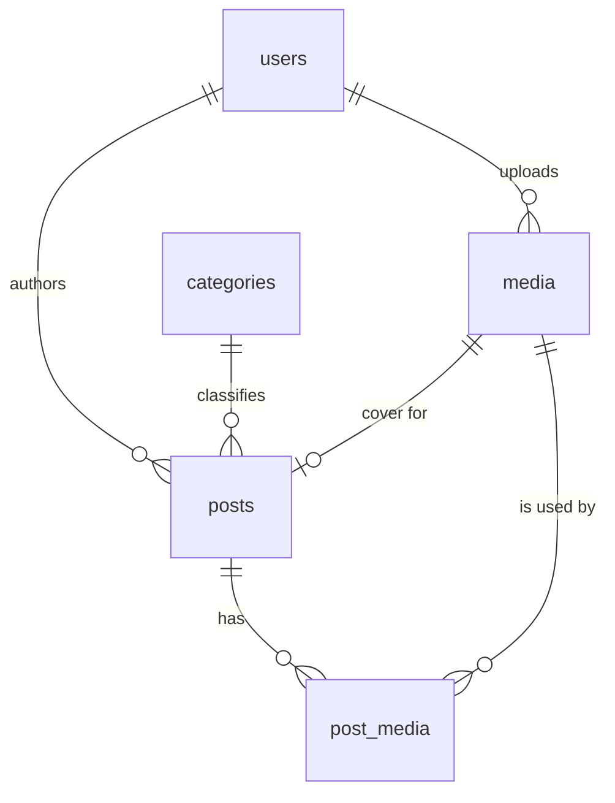

# Campus Kabar — Development Progress Report

**Date:** 17 November 2026
**Branch:** `feat/db-migrations`
**Scope covered:** Milestone 0 (design approval) and Milestone 2 (database foundation, verified)
**Report status:** factual snapshot of the working tree and the verification database, updated after the verification run. Rollback, reseed, constraint enforcement, and the runtime pool were exercised.

---

## Next Session Handoff

**Read this section first.** Snapshot taken immediately before the Milestone 2 commit was requested.

### Status

| Item | State |
| --- | --- |
| Branch / HEAD | `feat/db-migrations` / `695b8e4 initial commit` |
| Milestone 0 — design | Complete; approved schema recorded in the guide §9 |
| Milestone 2 — database foundation | Implemented and verified on a disposable MySQL 8 instance; **staged for commit, not committed** |
| Milestone 1 — project foundation | Partial: Vite/React frontend exists; Express has dependencies but **no entry point or dev server** |
| Milestones 3–8 | Not started |

**Deliberately not done yet:** `.env` for the team's real database, staff authentication, any API route, Cloudinary integration, tags, `content_text` search, and a descending-index migration.

**Do not redo:** the five migrations are written and verified in both directions; the seed is applied and idempotent; Knex is installed and configured. Running `migrate:latest` again on the verification database is a no-op, not a rebuild.

### Next milestone: Express backend foundation

Close the remaining Milestone 1 gap before starting staff auth. Scope:

1. `backend/src/config/env.js` — load and validate required environment variables once, with no real secrets defaulted in code.
2. `backend/src/app.js` — build the Express app: JSON body parsing, deliberate CORS configuration, minimal request logging, `GET /api/health` that runs `SELECT 1` through the shared Knex instance, a JSON 404 handler, and a central error handler that does not leak stack traces.
3. `backend/src/server.js` — start HTTP on `PORT` (default 4000), fail clearly on startup errors, and close the Knex pool on `SIGINT`/`SIGTERM`.
4. `backend/package.json` — add `dev` (`nodemon src/server.js`) and `start` (`node src/server.js`).
5. Verify by starting the server and requesting the health endpoint with both working and deliberately broken database credentials; the failure must be a clear JSON response, not a crash.

Out of scope for that milestone: auth, JWT, bcrypt, post/category/media routes, Cloudinary, and frontend changes.

### Exact next steps

1. Get final approval and commit the staged Milestone 2 changes (nothing is committed yet).
2. Obtain the real `DB_*` values, create `backend/.env` (never committed), then run `npm run migrate` and `npm run seed` against that database.
3. Build the Express foundation above and verify the health endpoint.
4. Commit that as the backend-foundation milestone.
5. Only then start Milestone 3 (staff authentication and authorization).

### Remaining pre-commit tasks

- Review the staged diff and confirm no credentials, local-only paths, or generated files are included.
- Decide whether to accept the ascending feed indexes or add a `DESC` migration (does not block the commit).
- Commit with the prepared message once the user approves.

---

## 1. Current project architecture and technology stack

### Repository layout

```
campus-khabar/
├── backend/
│   ├── .env.example
│   ├── knexfile.js
│   ├── package.json
│   ├── package-lock.json
│   ├── migrations/
│   │   ├── 20261117090001_create_users.js
│   │   ├── 20261117090002_create_categories.js
│   │   ├── 20261117090003_create_media.js
│   │   ├── 20261117090004_create_posts.js
│   │   └── 20261117090005_create_post_media.js
│   ├── seeds/
│   │   └── 001_initial_categories.js
│   └── src/
│       └── db/
│           └── knex.js
├── frontend/            (unmodified Vite + React 19 template)
└── docs/
    ├── Campus-Kabar-Project-Guide.md
    └── DEVELOPMENT_PROGRESS.md   (this file)
```

### Stack

| Layer | Technology | Status |
| --- | --- | --- |
| Frontend | React 19 + Vite 8, ESLint 10 | Untouched; still the default template |
| Backend runtime | Node.js 22.23.4, Express 5 | Dependencies declared, no server file yet |
| Database | MySQL 8 (verified against 8.0.46) | Schema implemented via migrations |
| DB driver | `mysql2` 3.24.6 | Connection pool configured |
| Migrations / query builder | Knex.js 3.3.0 | Added in this milestone |
| Media storage | Cloudinary (approved) | Not integrated yet (Milestone 5) |
| Auth | JWT + bcrypt/Argon2 (planned) | Not implemented (Milestone 3) |

### Architecture rules in force

- React never connects to MySQL; all access goes through the Express API.
- The backend is organised by responsibility (`routes`, `controllers`, `services`, `middleware`, `database`, `validators`, `configuration`). Only `src/db/` exists so far.
- No microservices, no `campuses` table or tenancy assumptions until decided.
- JavaScript, not TypeScript.
- Secrets live in environment variables; `.env` is git-ignored and `.env.example` is committed.

### Database connection design

`backend/knexfile.js` exports one shared config for `development`, `test`, and `production`:

- `client: 'mysql2'`, `charset: 'utf8mb4'`.
- Host/port/user/password/database come from `DB_HOST`, `DB_PORT`, `DB_USER`, `DB_PASSWORD`, `DB_NAME` (loaded with `dotenv`, with local defaults).
- `timezone: 'Z'` plus a `pool.afterCreate` hook that runs `SET time_zone = '+00:00'` on every pooled connection, so all `DATETIME(3)` values are UTC end to end.
- Pool: `min: 0`, `max: 10`.
- Migrations: `backend/migrations`, table `knex_migrations`. Seeds: `backend/seeds`.

`backend/src/db/knex.js` requires that config, selects `process.env.NODE_ENV || 'development'`, throws on an unknown environment, and exports a single shared Knex instance so the process uses one pool.

---

## 2. Database schema decisions and approved ERD

Milestone 0 was approved before implementation. The approved design is now recorded in `docs/Campus-Kabar-Project-Guide.md` §9 ("Database Design (Approved)"), with resolved decisions listed in §14.

### Global conventions

- InnoDB, `utf8mb4` / `utf8mb4_0900_ai_ci`.
- Primary keys: `BIGINT UNSIGNED AUTO_INCREMENT`.
- Timestamps: `DATETIME(3)` in UTC (not `TIMESTAMP`, avoiding the 2038 limit).
- Enumerations: `VARCHAR(16)` + named `CHECK` constraints rather than MySQL `ENUM`, so new values are metadata-only changes. Knex has no `CHECK` builder API, so migrations use `knex.raw()`.
- Files never stored in MySQL; `media` holds metadata and an object-storage reference.

### Approved ERD



### Table decisions

**`users`** — one table, all rows are real login-capable accounts.
`id`, `name(120)`, `email(255)` unique, `password_hash` **NOT NULL**, `role` in (`admin`, `editor`, `reader`) default `editor`, `is_active`, `created_at`, `updated_at`.
`reader` is reserved for future use; no reader accounts and no reader login in V1. Because `password_hash` is NOT NULL, adding passwordless readers later requires a migration. Accounts are deactivated, never deleted.

**`categories`** — `id`, `name(120)` unique, `slug(160)` unique, `description(500)`, `is_active`, `sort_order`, timestamps. Referenced with `ON DELETE RESTRICT`; deactivate instead of deleting.

**`posts`** — `id`, `title(255)`, `slug(255)` unique, `summary(500)`, `content` JSON, `post_type` in (`news`, `article`, `notice`, `announcement`), `category_id` (RESTRICT, exactly one category in V1), `author_id` (RESTRICT), `cover_media_id` nullable (SET NULL, single source of truth for the cover), `status` in (`draft`, `published`, `unpublished`), `is_featured`, `published_at`, `expires_at`, `created_at`, `updated_at`, `deleted_at` (soft delete).
Rules: a published post must have `published_at`; `expires_at` must be later than `published_at` when both are set.
Slugs stay globally unique even after soft deletion; the delete routine rewrites the slug to `original-slug--deleted-<id>` so the original can be reused.

**`media`** — `id`, `media_type` in (`image`, `video`, `document`), `source_type` in (`upload`, `external`), `storage_provider(32)`, `storage_key(512)`, `file_url(1024)`, `file_name`, `mime_type`, `file_size`, `alt_text`, `width`, `height`, `duration_seconds DECIMAL(10,3)`, `uploaded_by` (SET NULL), `created_at`.
`UNIQUE (storage_provider, storage_key)` deduplicates uploads and makes registration idempotent. Non-external media must have a positive `file_size`. No binaries in MySQL.

**`post_media`** — junction for `gallery`, `inline`, `attachment` only (the cover is not duplicated here). Composite primary key `(post_id, media_id, usage_type)`, `sort_order`, `post_id` CASCADE, `media_id` RESTRICT.
Inline placement is preserved by media IDs inside `posts.content`; the service layer must guarantee every media ID in the JSON has a matching `post_media` row, because a foreign key cannot reach into JSON.

**Tags** — deferred out of Version 1 entirely.

### Media constraints and upload contract

- Images JPG/JPEG/PNG/WebP ≤ 5 MB; video MP4/WebM ≤ 100 MB; documents PDF and approved formats ≤ 10 MB.
- Signed direct browser→Cloudinary upload: backend issues `POST /api/media/signature`; the browser uploads; the browser then sends only `public_id` + `resource_type` to `POST /api/media`.
- The backend derives all metadata from the Cloudinary Admin API (`GET /resources/<resource_type>/upload?public_id=…`, Basic auth) and inserts the row, deduplicating on `(storage_provider, storage_key)`.
- Cloudinary secrets never reach the frontend. No file bytes pass through Express.
- `duration_seconds` stays nullable because video transcoding is asynchronous and duration may be missing immediately after upload.

---

## 3. Migration files created and their purpose

All migrations were created in this milestone and applied in one batch during verification.

| File | Purpose |
| --- | --- |
| `backend/migrations/20261117090001_create_users.js` | Creates `users` with unique email, role CHECK, `is_active`, UTC timestamps, `(role, is_active)` index. |
| `backend/migrations/20261117090002_create_categories.js` | Creates `categories` with unique name and slug, `is_active`, `sort_order`, `(is_active, sort_order)` index. |
| `backend/migrations/20261117090003_create_media.js` | Creates `media` with storage columns, unique `(storage_provider, storage_key)`, `uploaded_by` FK (SET NULL), `(media_type, created_at)` index, and three CHECK constraints. |
| `backend/migrations/20261117090004_create_posts.js` | Creates `posts` with JSON content, FKs to `categories`, `users`, `media`, six query indexes, and four CHECK constraints (enums, published-needs-date, expiry ordering). |
| `backend/migrations/20261117090005_create_post_media.js` | Creates the composite-key junction table with CASCADE on post, RESTRICT on media, usage-type CHECK, and `(media_id, usage_type)` index. |

Every migration implements `exports.down` as `knex.schema.dropTable(...)`. **Rollback was verified**: `knex migrate:rollback --all` removed all five tables and emptied `knex_migrations` in 6.192 s, and `migrate:latest` restored the full schema.

Related non-migration file:

| File | Purpose |
| --- | --- |
| `backend/seeds/001_initial_categories.js` | Seeds four categories: News (`news`), Articles (`articles`), Notices (`notices`), Announcements (`announcements`), with `onConflict('slug').ignore()`. **Applied and verified idempotent**: two consecutive `seed:run` executions left exactly 4 rows. |

---

## 4. Dependencies installed or changed

| Change | Detail |
| --- | --- |
| Added runtime dependency | `knex@^3.3.0` in `backend/package.json`; lockfile resolved `knex` 3.3.0 |
| Updated | `backend/package-lock.json` (246 added lines) |
| Added npm scripts | `migrate`, `migrate:rollback`, `migrate:make`, `seed` |
| Unchanged | `express@^5.3.0`, `cors@^2.8.6`, `dotenv@^18.0.10`, `mysql2@^3.24.6`, `nodemon@^3.1.14` |
| Not installed (deliberately) | `bcrypt`/`argon2` (Milestone 3), Cloudinary SDK (Milestone 5), `content_text` search support (undecided) |

Scripts now defined:

```json
"migrate": "knex migrate:latest",
"migrate:rollback": "knex migrate:rollback",
"migrate:make": "knex migrate:make",
"seed": "knex seed:run",
"test": "echo \"Error: no test specified\" && exit 1"
```

No frontend dependencies were added or changed.

---

## 5. Exact commands executed

### Inspection and environment discovery

```bash
git status --short
ls backend
grep -n "^## \|^### " docs/Campus-Kabar-Project-Guide.md
which mysql mysqld mariadb docker
node -v; npm -v
nc -z 127.0.0.1 3306
mysql -uroot -e "SELECT VERSION(); SHOW DATABASES;"          # ERROR 1698
whoami; id
sudo -n mysql -e "SELECT VERSION(); SHOW DATABASES;"          # sudo requires a password
docker ps --format '{{.Names}} {{.Image}} {{.Ports}}'
mysql -udev -pdev -e "SELECT 1"                              # ERROR 1045
ss -ltnp | grep 3306
docker images --format '{{.Repository}}:{{.Tag}} {{.Size}}'
```

### Verification database (disposable, local Docker)

```bash
docker pull mysql:8.0                                        # background, ~ minute
docker rm -f campus-kabar-verify
# Export the throwaway container password in your own shell first; it is not recorded here.
export DB_PASSWORD="<local-verification-password>"
docker run -d --name campus-kabar-verify \
  -e MYSQL_ROOT_PASSWORD="$DB_PASSWORD" \
  -e MYSQL_DATABASE=campus_kabar \
  -p 3307:3306 mysql:8.0
# readiness polls via: docker exec campus-kabar-verify mysqladmin ping -uroot -p"$DB_PASSWORD"
#                      docker exec campus-kabar-verify mysql -uroot -p"$DB_PASSWORD" -N -e "SELECT VERSION();"
```

### Dependency install

```bash
cd backend && npm install knex@^3
```

### Migration attempts

```bash
# Attempt 1 — timed out after 120 s, was killed mid-run
cd backend
DB_HOST=127.0.0.1 DB_PORT=3307 DB_USER=root DB_PASSWORD="$DB_PASSWORD" DB_NAME=campus_kabar \
  npx knex migrate:latest

# Connectivity sanity check (succeeded)
node -e "mysql2 createConnection(...); select version()"

# Attempt 2 — refused because the killed run left the lock held
DB_HOST=127.0.0.1 DB_PORT=3307 DB_USER=root DB_PASSWORD="$DB_PASSWORD" DB_NAME=campus_kabar \
  timeout 45 ./node_modules/.bin/knex migrate:latest --verbose

# Diagnostics
docker exec campus-kabar-verify mysql -uroot -p"$DB_PASSWORD" -N -e \
  "SHOW TABLES FROM campus_kabar; SELECT * FROM campus_kabar.knex_migrations_lock; SHOW PROCESSLIST;"
ps aux | grep -E "knex|node"

# Unlock, then retry
DB_... ./node_modules/.bin/knex migrate:unlock
DB_... ./node_modules/.bin/knex migrate:latest

# Clean reset of the verification database
docker exec campus-kabar-verify mysql -uroot -p"$DB_PASSWORD" -e \
  "DROP DATABASE campus_kabar; CREATE DATABASE campus_kabar CHARACTER SET utf8mb4 COLLATE utf8mb4_0900_ai_ci;"

# Successful run (2 m 29.633 s)
cd backend
DB_HOST=127.0.0.1 DB_PORT=3307 DB_USER=root DB_PASSWORD="$DB_PASSWORD" DB_NAME=campus_kabar \
  ./node_modules/.bin/knex migrate:latest
```

### Post-run verification

```bash
docker exec campus-kabar-verify mysql -uroot -p"$DB_PASSWORD" -N -e "
  SHOW TABLES FROM campus_kabar;
  SELECT id,name,batch,migration_time FROM campus_kabar.knex_migrations ORDER BY id;
  SELECT * FROM campus_kabar.knex_migrations_lock;
  SELECT COUNT(*) FROM campus_kabar.categories;
  SELECT CONSTRAINT_NAME, CHECK_CLAUSE FROM information_schema.CHECK_CONSTRAINTS
    WHERE CONSTRAINT_SCHEMA='campus_kabar';"

# Full DDL dump
docker exec campus-kabar-verify mysql -uroot -p"$DB_PASSWORD" -N -e "SHOW CREATE TABLE campus_kabar.<table>\G"

git diff --stat
docker ps --filter name=campus-kabar-verify --format '{{.Names}} | {{.Image}} | {{.Ports}} | {{.Status}}'
```

### Verification run (after the report was first written)

```bash
cd backend
export DB_HOST=127.0.0.1 DB_PORT=3307 DB_USER=root DB_PASSWORD="$DB_PASSWORD" DB_NAME=campus_kabar

./node_modules/.bin/knex migrate:list
./node_modules/.bin/knex migrate:rollback --all      # 6.192 s
# state check: only knex_migrations + knex_migrations_lock remain, 0 rows applied
./node_modules/.bin/knex migrate:latest              # 2 m 18.779 s, "Batch 1 run: 5 migrations"
./node_modules/.bin/knex seed:run                    # 4 categories
./node_modules/.bin/knex seed:run                    # still 4 categories

# constraint smoke tests via the mysql client (one INSERT per case)
# then a valid published post + post_media row, then deletion of the test rows

# runtime pool, not the CLI
node -e "const db = require('./src/db/knex'); ..."
```

These statements mutated the disposable verification database only. No `.env` was created and no application source was changed.

---

## 6. Migration execution results, including errors

### What actually happened

1. **First attempt** (`npx knex migrate:latest`) was killed by the tool's 120-second timeout. It had already created `users`, `categories`, `media`, and `posts`, but only the first **three** migrations were recorded in `knex_migrations`. The migration lock was left at `is_locked = 1`.
2. **Second attempt** correctly refused:
   `Can't take lock to run migrations: Migration table is already locked`.
3. `knex migrate:unlock` succeeded, but the next run failed with:
   `create table posts ... - Table 'posts' already exists`
   because the unrecorded table from the killed run was still present.
4. The verification database was dropped and recreated, then the migration run **succeeded**:
   `Batch 1 run: 5 migrations`.

### Final recorded batch

| ID | Migration | Batch | Recorded at (UTC) |
| --- | --- | --- | --- |
| 1 | `20261117090001_create_users.js` | 1 | 2026-11-17 07:36:43 |
| 2 | `20261117090002_create_categories.js` | 1 | 2026-11-17 07:36:50 |
| 3 | `20261117090003_create_media.js` | 1 | 2026-11-17 07:37:22 |
| 4 | `20261117090004_create_posts.js` | 1 | 2026-11-17 07:38:29 |
| 5 | `20261117090005_create_post_media.js` | 1 | 2026-11-17 07:38:53 |

Total wall time: **2 m 29.633 s**, almost entirely waiting on DDL (32 s, 67 s, and 24 s gaps between migrations). The first-attempt timeout was an environment-speed problem in this sandbox, not a schema or code defect: the identical statements completed on the clean run, and the per-migration timestamps show the same slow DDL.

### Error messages observed verbatim

```
ERROR 1698 (28000): Access denied for user 'root'@'localhost'
MigrationLocked: Migration table is already locked
Table 'posts' already exists
```

No syntax errors were reported for any generated DDL, including the `DEFAULT CURRENT_TIMESTAMP(3) ON UPDATE CURRENT_TIMESTAMP(3)` expressions and the `knex.raw()` CHECK constraints.

### Verification run results

| Check | Command | Result |
| --- | --- | --- |
| Knex status | `knex migrate:list` | 5 completed, no pending |
| Reversibility | `knex migrate:rollback --all` | **Pass** — 5 migrations rolled back in 6.192 s; only `knex_migrations` and `knex_migrations_lock` remained, with 0 applied rows |
| Re-apply | `knex migrate:latest` | **Pass** — `Batch 1 run: 5 migrations`, 2 m 18.779 s |
| Seed | `knex seed:run` ×2 | **Pass** — 4 categories after each run (idempotent) |
| `users.role` enum | insert `role='superuser'` | **Pass** — rejected, `ERROR 3819` / `chk_users_role` |
| `media` upload without size | insert `source_type='upload'` with no `file_size` | **Pass** — rejected, `ERROR 3819` / `chk_media_file_size` |
| Storage dedupe | duplicate `(storage_provider, storage_key)` | **Pass** — rejected, `ERROR 1062` / `uq_media_storage_object` |
| Published without date | insert `status='published'` with no `published_at` | **Pass** — rejected, `ERROR 3819` / `chk_posts_published_at` |
| `posts.post_type` enum | insert `post_type='blog'` | **Pass** — rejected, `ERROR 3819` / `chk_posts_post_type` |
| `post_media.usage_type` enum | insert `usage_type='cover'` | **Pass** — rejected, `ERROR 3819` / `chk_post_media_usage_type` |
| Valid write path | published post + `post_media` inline row | **Pass** — inserted and read back with `cover_media_id`, JSON content, and joined media |
| Runtime pool | load `src/db/knex.js` | **Pass** — `@@session.time_zone = '+00:00'`, read the seeded categories, pool destroyed cleanly |

After the tests, the user, media, post, and `post_media` rows created for verification were deleted, leaving only the four seeded categories.

---

## 7. Current database state and inconsistencies

### Verification database

- Engine: MySQL **8.0.46** in Docker container `campus-kabar-verify` (image `mysql:8.0`), mapped `3307 → 3306`, status `Up`.
- Credentials: user `root` with a password supplied through the `DB_PASSWORD` environment variable (intentionally not recorded); database `campus_kabar` created with `utf8mb4` / `utf8mb4_0900_ai_ci`.
- This is a **throwaway verification instance**, not a project database. The host's own MySQL on `127.0.0.1:3306` is running but inaccessible to the current user (`root` uses socket auth and `sudo` needs a password; no credentials were found in the project).

### Verified schema contents

Tables present: `users`, `categories`, `media`, `posts`, `post_media`, plus `knex_migrations` and `knex_migrations_lock`.

- `knex_migrations_lock.is_locked = 0` (lock released).
- `knex_migrations` contains exactly the five rows listed in §6.
- `categories` contains the **4 seeded rows** (`news`, `articles`, `notices`, `announcements`).
- `users`, `media`, `posts`, and `post_media` are **empty** — the smoke-test rows were deleted after verification.
- All 5 tables use `ENGINE=InnoDB`, `DEFAULT CHARSET=utf8mb4 COLLATE=utf8mb4_0900_ai_ci`.
- All 9 CHECK constraints exist and were read back from `information_schema.CHECK_CONSTRAINTS`:
  `chk_users_role`, `chk_media_type`, `chk_media_source_type`, `chk_media_file_size`,
  `chk_posts_post_type`, `chk_posts_status`, `chk_posts_published_at`,
  `chk_posts_expiry_after_publication`, `chk_post_media_usage_type`.
- Foreign keys confirmed: `media.uploaded_by → users.id` (SET NULL);
  `posts.category_id → categories.id` (RESTRICT); `posts.author_id → users.id` (RESTRICT);
  `posts.cover_media_id → media.id` (SET NULL);
  `post_media.post_id → posts.id` (CASCADE); `post_media.media_id → media.id` (RESTRICT).
- `post_media` primary key is `(post_id, media_id, usage_type)`.
- `updated_at` columns are `DEFAULT CURRENT_TIMESTAMP(3) ON UPDATE CURRENT_TIMESTAMP(3)` as intended.

### Known deviations and caveats

1. **Index sort direction.** The guide specifies `published_at DESC` in the feed indexes, but Knex's `table.index([...])` created them **ascending**
   (`idx_posts_public_feed (status, deleted_at, published_at, id)`, and the type/category/featured equivalents). MySQL 8 can scan an ascending index backwards for `ORDER BY published_at DESC, id DESC`, so the intended public-feed queries are still served, but the index is not literally descending. Decide whether to accept this or switch those three indexes to explicit `DESC` columns via `knex.raw()` in a follow-up migration.
2. **Schema mutated before commit.** The approved design is documented in the guide and the code matches it, but nothing has been committed; the migrations exist only in the working tree.
3. **Verified paths.** Rollback, reseed, constraint rejection, a valid post + `post_media` insert, and the runtime pool have all been exercised (§6). Still untested: behaviour against the team's real MySQL instance, concurrent writes, and load.
4. **Runtime pool verified, but not configured for a real database.** `backend/src/db/knex.js` was loaded with the verification environment variables and worked. There is still no `.env`; without one the module falls back to `127.0.0.1:3306`, user `root`, empty password, which is not this database and will fail on the host instance.
5. **Earlier partial state is gone.** The orphaned `posts` table and stale migration lock from the killed first attempt were resolved by dropping and recreating the verification database, so there is no lingering inconsistency in the verification DB.

---

## 8. Files modified during this milestone

### Modified

| File | Change |
| --- | --- |
| `docs/Campus-Kabar-Project-Guide.md` | §9 replaced with the approved design: conventions, Mermaid ERD, full column tables for `users`/`categories`/`posts`/`media`/`post_media`, CHECK constraints, index plan, deletion rules, DB-vs-service integrity split, tags deferral, and the 7-step Cloudinary upload workflow. §14 now lists resolved decisions separately from open ones (including the pending `content_text` search decision). Earlier uncommitted edits from Milestone 0 (3-role decision in §3, Knex in the §7 stack table) are also present in this diff. A follow-up edit re-split the §9 heading, which an inspection found merged with the previous paragraph as `microservices.## 9. Database Design (Approved)`; it now renders again. |
| `backend/package.json` | Added `knex@^3.3.0` and the four database scripts. |
| `backend/package-lock.json` | Lockfile updated for Knex (246 added lines). |

### Created

| File | Purpose |
| --- | --- |
| `backend/knexfile.js` | MySQL connection, UTC pinning, pool, migration/seed directories, per-environment exports. |
| `backend/src/db/knex.js` | Shared application Knex instance. |
| `backend/migrations/20261117090001_create_users.js` | `users` table + role CHECK. |
| `backend/migrations/20261117090002_create_categories.js` | `categories` table. |
| `backend/migrations/20261117090003_create_media.js` | `media` table + 3 CHECKs + unique storage object. |
| `backend/migrations/20261117090004_create_posts.js` | `posts` table + 4 CHECKs + 6 indexes. |
| `backend/migrations/20261117090005_create_post_media.js` | `post_media` junction table + usage CHECK. |
| `backend/seeds/001_initial_categories.js` | Four initial categories; applied and verified idempotent against the verification database. |
| `backend/.env.example` | `DB_HOST`, `DB_PORT`, `DB_USER`, `DB_PASSWORD`, `DB_NAME`. Cloudinary keys intentionally omitted until Milestone 5. |
| `docs/DEVELOPMENT_PROGRESS.md` | This report. |

### Untouched

`frontend/**` (still the default Vite template), `.gitignore` (already covers `node_modules`, `.env`, `.env.*`, `dist`, logs), and all backend source outside `src/db/`.

Git state at report time — **staged for the first Milestone 2 commit, nothing committed**:

```
M  backend/package-lock.json
M  backend/package.json
M  docs/Campus-Kabar-Project-Guide.md
A  backend/.env.example
A  backend/knexfile.js
A  backend/migrations/20261117090001_create_users.js
A  backend/migrations/20261117090002_create_categories.js
A  backend/migrations/20261117090003_create_media.js
A  backend/migrations/20261117090004_create_posts.js
A  backend/migrations/20261117090005_create_post_media.js
A  backend/seeds/001_initial_categories.js
A  backend/src/db/knex.js
A  docs/DEVELOPMENT_PROGRESS.md
```

No `.env`, `node_modules`, database files, or Docker artifacts are tracked or staged.

---

## 9. Remaining tasks and exact next steps

Milestone 2's schema, migrations, seeds, and constraint behaviour are now **verified on the disposable MySQL 8 instance** (§6). Remaining work, in order:

1. **Configure the real database.** Create `backend/.env` from the example with the credentials the team actually uses:
   ```bash
   cd backend && cp .env.example .env   # then edit DB_* values
   ```
   The host MySQL on 3306 is still inaccessible to the current user (`root` is socket-auth-only and `sudo` needs a password), so verification continued against the container on 3307. Creating `.env` needs the real credentials; do not invent them.
2. **Decide the index-direction deviation** from §7: accept ascending feed indexes (MySQL 8 can scan them backwards for the feed ordering) or add a follow-up migration with explicit `DESC` columns.
3. **Resolve the search decision**: if keyword search over post bodies is required in V1, add a migration for `posts.content_text MEDIUMTEXT` plus a FULLTEXT index (not present now).
4. **Commit** the milestone together with the guide update, once the user has verified the result.
5. **Then Milestone 3** (not started): install `bcrypt`/`argon2`, build the guarded first-Admin bootstrap script driven by env vars, implement login/current-user, and add authentication + role middleware. No admin script exists yet — deliberately deferred, since the guide places it in Milestone 3.
6. **Clean up the disposable container** when no longer needed:
   ```bash
   docker rm -f campus-kabar-verify
   ```

---

## 10. Important decisions and constraints from the project guide

### Locked decisions

- **Roles:** one `users` table with `admin`, `editor`, `reader`; `password_hash` NOT NULL for every row; no reader accounts, registration, or login in V1; deactivate users instead of deleting them.
- **Stack:** React + Express + MySQL 8 + `mysql2` + Knex.js; JavaScript, not TypeScript; secrets only in env vars.
- **Content model:** four post types; exactly one category per post; cover stored only in `posts.cover_media_id`; `deleted_at`, `published_at`, and `expires_at` retained; soft delete with slug rewriting.
- **Enums as VARCHAR + CHECK**, not MySQL `ENUM`; `CHECK` requires `knex.raw()`.
- **Media:** Cloudinary first; real image, video, and document uploads all required in V1; external video embeds allowed; signed direct browser uploads; backend verifies through the Cloudinary Admin API; metadata derived server-side; never trust client-supplied MIME/size; no binaries in MySQL.
- **Tags are out of V1.**
- **No tenancy:** no `campuses` table and no `campus_id` until decided.
- **Soft delete is posts-only;** categories and media are not soft-deleted in V1.
- **Service-layer invariant:** every media ID in `posts.content` must have a matching `post_media` row; `cover_media_id` must be an image already associated with the post.

### Open stakeholder decisions (do not guess)

- Single-campus vs multi-campus operation.
- Whether Editors may publish directly or need Admin approval.
- V1 language.
- Hosting environment.
- Whether body keyword search is required (`content_text` + FULLTEXT).
- Audit trail for content and staff actions.
- Retention period for soft-deleted posts.
- Display timezone for staff and public pages.

### Process constraints observed

- This milestone was carried out only after explicit approval of the design.
- Schema work ran against a disposable local MySQL container; no production or shared database was touched.
- Nothing has been committed or pushed; the working tree holds all changes on `feat/db-migrations`.
- No frontend work, no authentication, no API routes, and no Cloudinary integration were started.
